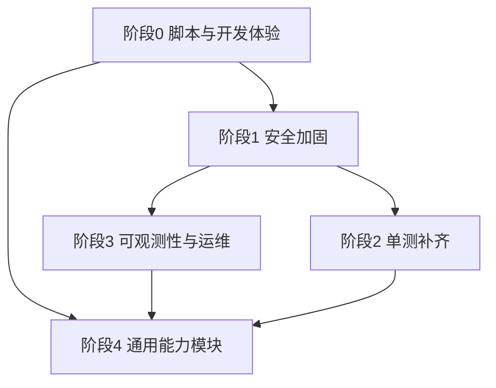

## 需求概述

对 SystemBase 基础框架做一次全面体检式增强：找出可优化点并补齐中小后台通用能力，含脚本工具链。输出为「分阶段、可独立验证与回滚」的实施计划。

## 用户已确认的范围

1. **优化方向（四项全选）**

- 通用能力模块：数据字典、系统参数配置（运行时可改、不重启）、文件/附件管理、通知公告
- 安全加固：弱密码校验与首次强制改密、登录验证码/失败锁定、IP 白黑名单、密码过期策略
- 脚本与开发体验：数据库备份/恢复脚本、远程环境体检命令、CRUD 代码生成器、pre-commit 钩子、Swagger API 文档
- 可观测性与运维：健康检查细分（DB/Redis 依赖探测）、Prometheus 指标暴露、日志告警、多实例一致性优化

2. **测试**：仅补后端核心模块单测（user / role / menu / monitor 及新增安全逻辑），不引入前端 Vitest 与 E2E Playwright
3. **交付**：分阶段推进，先脚本与低风险加固，后通用模块

## 现状确认（已探查）

- 后端模块：auth / user / role / menu / job / monitor / example；单测仅 6 个（pagination、log-reader、permission-cache、auth.service、job-registry、job.service）
- Prisma 模型：User / Role / Menu / UserRole / RoleMenu / RefreshToken / Job / SysLock——**无配置、字典、文件、通知表**
- 健康检查：仅 `/api/health`（只探 DB，200/503）
- 无 Swagger、无 husky/lint-staged、无备份脚本、`.github/` 已删除（CI 不作为卡口）
- 已有：RBAC + 权限缓存（进程内，多实例延迟 `PERMISSION_CACHE_TTL`）、动态定时任务、JWT 轮换、登录限流、日志只落文件

## 技术栈（沿用现有，不引入新范式）

- 后端：NestJS 10 + Prisma 5 + MySQL 8 + Jest；新增依赖仅限 `@nestjs/swagger`（文档）、`svg-captcha`（验证码，可选开关）
- 前端：Vue 3 + Element Plus + Pinia + vue-router 4 + Vite 5（新增页面沿用现有表格页/表单抽屉风格）
- 脚本：`sb.sh` / `sb.ps1` 统一入口 + `start-local.*` / `deploy.*` 实现脚本，Mac/Linux 与 Windows 双版本同步
- 指标：零依赖自行输出 Prometheus 文本格式（不引 `prom-client`，契合框架「零外部依赖」风格）

## 实施策略

按「低风险 → 高风险」分 4 阶段，每阶段可独立验证与回滚：



### 阶段 0：脚本与开发体验（低风险，无表结构变更）

- **备份/恢复**：`./sb.sh <env> db-backup [备注]` / `db-restore <文件>`。本地直接 `mysqldump` 到 `backup/`；远程通过 SSH 在服务器 `shared/backup` 生成后 `scp` 回本地。恢复前强制二次确认并自动先备份当前库
- **环境体检**：`./sb.sh <env> doctor`——版本、PM2/Nginx/MySQL、磁盘、今日 ERROR 数、健康检查，并**比对本地 env 应用段与服务器 `shared/.env` 差异**（防止本地改了配置忘记发布）
- **pre-commit**：`.githooks/pre-commit`（`git config core.hooksPath .githooks`）跑 `pnpm lint && pnpm test`，不引入 husky 依赖
- **Swagger**：接入 `@nestjs/swagger`，路由 `/api/docs`，生产默认关闭（`SWAGGER_ENABLED`），DTO 用 `@ApiProperty` 渐进标注，与 `whitelist + forbidNonWhitelisted` 共存
- **CRUD 生成器**：`./sb.sh gen-crud <模块名>`（Node 脚本），按 `example` 模块模板生成后端骨架 + DTO + 菜单/权限点 seed 片段 + 前端列表页骨架 + 单测骨架

### 阶段 1：安全加固（配置驱动，默认关闭/宽松，保证不锁死自己）

- 密码策略：`PASSWORD_MIN_LENGTH`（默认 8）+ 复杂度 + 弱密码字典 + 不得包含用户名；管理员重置与自助改密共用校验（现 bcrypt rounds=10）
- 首次登录强制改密：`User` 增加 `mustChangePassword`；登录返回标志，前端跳全屏改密页，守卫放行改密/登出接口
- 失败锁定：连续失败 N 次锁定 M 分钟（复用 `SysLock` 表或 Redis，避免新表），登录日志已有失败原因可直接复用
- 验证码：`LOGIN_CAPTCHA=off|auto|on`，失败 N 次后要求（依赖 `svg-captcha`，可缺省降级为不启用）
- 密码过期：`PASSWORD_EXPIRE_DAYS`（默认 0 关闭），比对 `pwdUpdatedAt`
- IP 白/黑名单：中间件基于 `TRUST_PROXY` 取真实 IP，规则先走 env，阶段 4 后迁移到「系统参数」表

### 阶段 2：后端核心单测（用户指定范围）

补 `user.service.spec`（含角色变更触发 `invalidateUser/invalidateAll`）、`role.service.spec`（授权后缓存失效、内置角色保护、删除校验）、`menu.service.spec`（树构建、有子节点禁止删除）、`monitor.service.spec`（按日期/级别/分类过滤、文件下载），并覆盖阶段 1 新增安全逻辑

### 阶段 3：可观测性与运维

- 健康检查细分：`/api/health`（存活，仅进程）+ `/api/health/ready`（就绪：DB、Redis 仅 `LOCK_DRIVER=redis` 时探测、日志目录可写），保持 503 语义（curl -sf 依赖状态码）
- 指标：`/api/metrics`（`METRICS_ENABLED` 开关，零依赖文本格式：请求计数/耗时分位、进程、任务执行计数）
- 日志告警：新增定时任务 handler `system.logAlert`，扫描当日 ERROR 超阈值写 WARN 并可配 webhook
- 多实例一致性：权限缓存跨实例失效——`LOCK_DRIVER=redis` 时走 Redis pub/sub 广播 `invalidateUser/invalidateAll`；db 模式提供「系统参数里的全局权限版本号」低频校验（权衡：pub/sub 实时但依赖 Redis，版本号轮询有 TTL 级延迟但零依赖）

### 阶段 4：通用能力模块

每个模块统一交付：Prisma 模型 + 迁移 + seed（菜单/权限点）+ service/controller/dto + 前端页面 + 单测

- 系统参数 `SysConfig`：key/value/类型/内置标记，运行时可改，带缓存与失效，承载登录策略、IP 规则等
- 数据字典 `Dict` + `DictItem`：类型/项、缓存、`/api/dict/:type`、前端字典下拉组件
- 文件管理 `File`：大小/类型白名单校验、本地存储（目录可配）、下载鉴权、上传者记录、孤儿文件清理任务
- 通知公告 `Notice`：发布/置顶/有效期/已读记录，前端公告栏 + 消息中心

## 注意事项（防回归）

- **shell 脚本**：`$变量` 后紧跟中文/全角字符必须写 `${变量}`（曾触发 `unbound variable` 导致启动崩溃）；`.sh` 与 `.ps1` 必须同步改；新增脚本用 `bash -n` 校验
- **迁移**：新增表走 `prisma migrate dev --name` 生成迁移文件，服务器发布由 `migrate deploy` 应用；遵循「先加后删」保证可回滚
- **权限**：新模块的菜单/权限点必须进 seed（幂等），前端菜单由后端返回自动生效，无需改前端路由
- **向后兼容**：所有安全策略默认关闭或宽松（如 `PASSWORD_MIN_LENGTH=8`、过期 0 天），避免升级后管理员被锁死；`admin/admin123` 保留但登录后可触发强制改密
- **性能**：字典/系统参数走进程内缓存（复用 `PermissionCacheService` 的失效思路），避免每请求查库；文件上传限制 `BODY_LIMIT` 之外单独配置，并同步 nginx `client_max_body_size`

## 目录结构

```
apps/server/
├── prisma/schema.prisma                    # [MODIFY] 阶段1: User 加 mustChangePassword/pwdUpdatedAt；阶段4: 加 SysConfig/Dict/DictItem/File/Notice
├── prisma/migrations/<时间戳>_*/           # [NEW] 每个阶段一个迁移
├── src/
│   ├── core/
│   │   ├── health/health.controller.ts     # [MODIFY] 拆分为 /health 存活 + /health/ready 就绪（DB/Redis/日志目录）
│   │   ├── metrics/metrics.controller.ts   # [NEW] Prometheus 文本指标（开关控制）
│   │   ├── security/
│   │   │   ├── password-policy.ts          # [NEW] 密码强度/弱密码字典/过期判定（纯函数，易单测）
│   │   │   ├── login-guard.service.ts      # [NEW] 失败计数与锁定、验证码签发校验
│   │   │   ├── ip-filter.middleware.ts     # [NEW] IP 白/黑名单（真实 IP 取自 TRUST_PROXY）
│   │   │   └── permission-cache.service.ts # [MODIFY] 阶段3: Redis pub/sub 广播失效
│   │   └── config/env.validation.ts        # [MODIFY] 新增安全/观测相关环境变量校验
│   └── modules/
│       ├── auth/                           # [MODIFY] 登录流程接入策略/锁定/验证码/强制改密标志
│       ├── config/                         # [NEW] 系统参数（CRUD + 缓存 + 失效）
│       ├── dict/                           # [NEW] 数据字典（类型/项 + 缓存 + 查询接口）
│       ├── file/                           # [NEW] 文件上传下载（白名单校验 + 鉴权下载）
│       ├── notice/                         # [NEW] 通知公告（发布/置顶/已读）
│       └── job/job-registry.ts             # [MODIFY] 注册 system.logAlert 告警 handler
├── src/database/seed.ts                    # [MODIFY] 新模块菜单/权限点、内置字典与系统参数
└── test 同级 *.spec.ts                     # [NEW] user/role/menu/monitor/config/dict 等单测

apps/web/src/
├── api/{config,dict,file,notice}.ts        # [NEW] 新模块 API 封装
├── views/system/config/ConfigList.vue      # [NEW] 系统参数页
├── views/system/dict/DictList.vue          # [NEW] 数据字典页
├── views/system/file/FileList.vue          # [NEW] 文件管理页
├── views/system/notice/NoticeList.vue      # [NEW] 公告管理页
├── views/profile/ForceChangePwd.vue        # [NEW] 强制改密全屏页
├── components/DictSelect.vue               # [NEW] 字典下拉组件（复用字典缓存）
├── layouts/AdminLayout.vue                 # [MODIFY] 公告入口/消息中心
└── router/index.ts                         # [MODIFY] 强制改密拦截（登录态标志）

deploy/
├── server/db-backup.sh                     # [NEW] 服务器端备份/恢复逻辑（被 sb 远程调用）
├── server/doctor.sh                        # [NEW] 远程环境体检（版本/服务/磁盘/错误数/env 差异）
scripts/
└── gen-crud.mjs                            # [NEW] CRUD 代码生成器（按 example 模板）

根目录
├── sb.sh / sb.ps1                          # [MODIFY] 新增 db-backup/db-restore/doctor/gen-crud 命令分发
├── start-local.sh / .ps1                   # [MODIFY] 本地备份命令支持
├── deploy.sh / .ps1                        # [MODIFY] 远程备份/体检命令支持
├── .githooks/pre-commit                    # [NEW] lint + test 卡口
├── gen-random.py                           # 已存在，密码/密钥生成复用
└── docs/、README.md、CHANGELOG.md          # [MODIFY] 新能力与安全配置说明
```

## 关键结构（接口级）

```ts
// core/security/password-policy.ts（纯函数，便于单测）
export interface PasswordPolicy {
  minLength: number;            // PASSWORD_MIN_LENGTH，默认 8
  requireComplexity: boolean;   // 大小写+数字
  expireDays: number;           // PASSWORD_EXPIRE_DAYS，0=不过期
}
export function checkPassword(pwd: string, username: string, p: PasswordPolicy): string[]; // 返回问题列表，空数组=通过

// 登录安全：LoginGuardService（阶段1）
export interface LoginDecision {
  allowed: boolean;
  reason?: 'LOCKED' | 'CAPTCHA_REQUIRED' | 'BAD_CREDENTIALS' | 'EXPIRED';
  mustChangePassword?: boolean;
}
```

```ts
// 系统参数缓存契约（阶段4，复用权限缓存的失效思路）
export interface ConfigEntry { key: string; value: string; type: 'STRING' | 'NUMBER' | 'BOOL' | 'JSON'; builtin: boolean; }
// 读：进程内缓存 + TTL；写：更新后广播失效（db 模式：递增全局版本号；redis 模式：pub/sub）
```

## 设计取向

延续现有管理端视觉与交互，不为新页面另起风格：左侧菜单 + 顶栏（头像下拉/公告入口）的后台布局，Element Plus 表格 + 分页 + 表单抽屉/对话框，主色沿用登录页深蓝渐变体系（#0a1929 / #12365f / #1b5a8f）与 Element Plus 强调蓝 #409eff。

## 新增页面

- **系统参数**：分组折叠的键值表格，行内编辑 + 即时保存，内置项只读并带「内置」标签，开关型参数用 el-switch
- **数据字典**：左树（字典类型）+ 右表（字典项）双栏，项支持拖拽排序与启用/停用
- **文件管理**：卡片/列表切换视图，上传区（拖拽 + 进度条 + 类型图标），操作列含下载/复制链接/删除，删除需二次确认
- **通知公告**：列表 + 置顶标记 + 有效期区间筛选，富文本/纯文本编辑抽屉，顶栏铃铛入口显示未读红点
- **强制改密**：全屏居中卡片，实时强度条 + 规则校验清单，提交成功后自动回首页

## 交互细节

- 表格页统一：顶部筛选栏（左）+ 工具栏（右），表格空状态插画，危险操作红色文字按钮 + Popconfirm
- 微交互：行 hover 高亮、保存成功 toast、上传进度、未读数字徽标，避免整页刷新
- 响应式：1280px 以下筛选栏换行，抽屉宽度自适应（min 480px / max 720px）

## Agent Extensions

### SubAgent

- **code-explorer**
- Purpose：实现新模块/脚本前，定位现有约定与调用点（example 模块骨架、seed 的菜单与权限点写法、PermissionCacheService 的全部失效调用点、sb.sh 命令分发结构）
- Expected outcome：新代码与脚本严格贴合现有风格，避免重复造轮子与遗漏注册点

### Skill

- **agent-browser**
- Purpose：每个阶段完成后做端到端冒烟（登录 → 新页面 → 强制改密 → 字典下拉生效 → 文件上传下载），替代仅靠肉眼验证
- Expected outcome：像「登录不跳转」这类只有真实浏览才能暴露的问题能被提前发现

### Skill

- **lsp-code-analysis**
- Purpose：改动 auth/登录链路时精确查找符号引用（如 JwtStrategy、PermissionCacheService.invalidateAll 的调用点），评估影响面
- Expected outcome：安全加固与缓存一致性改动不漏改调用点