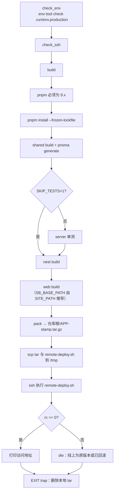
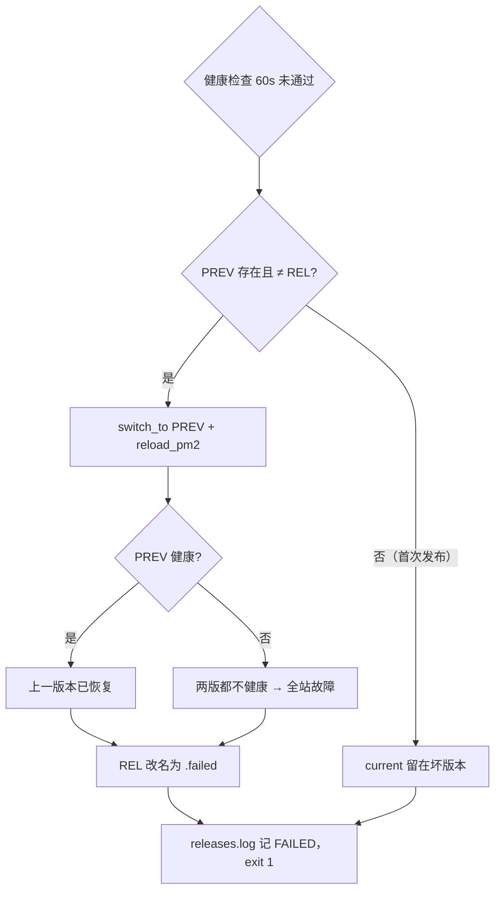

# 远程部署流程审查（deploy.sh 全分支梳理 + 缺陷与风险）

> 审查日期：2026-11-06　｜　范围：`deploy.sh` 及其调用的 `deploy/server/*`（`remote-deploy.sh` / `setup-server.sh` / `ops.sh` / `db-backup.sh` / `setup-ssl.sh` / `nginx-setup.sh` / `env-tool.cjs` / `ecosystem.config.js`）
> Windows 版 `deploy.ps1` 只核对了与本文问题相关的几处（标注「ps1 同样存在」）。
> 调用链速查见 [flow.md](./flow.md)；本文关注**每一步失败后线上处于什么状态**，以及**哪里有错、哪里有风险**。

---

## 修复状态（2026-11-06 更新）

> 下文第一～四节保留**审查时**的原始描述（行号对应修复前的脚本），修复后的流程以 [flow.md](./flow.md) / [deploy.md](./deploy.md) 为准。

| 编号 | 状态 | 处理方式 | 验证 |
|---|---|---|---|
| E1 | ✅ 已修复 | `db-backup.sh` 先清理过期备份再输出，最后一行固定 `BACKUP_FILE=<路径>`；`deploy.sh` / `deploy.ps1` 按标记提取 | 桩命令模拟：存在 9 天前的旧备份时，取到的仍是新文件 |
| E2 | ✅ 已修复 | `pack()` 改为直接调用（结果写全局变量），新增 `verify_pack()` 用 `tar -tzf` 校验 8 项关键文件；服务器解压后再校验一次 | 实测：删掉 `index.html` 后被拦截，不上传 |
| E3 | ✅ 已修复 | fresh 改为**先备份再停服务**；停服务后任何一步失败，`on_exit` 都会重新拉起服务；失败提示改为如实说明 | 模拟：清库失败后 PM2 先 stop 再 startOrReload |
| E4 | ✅ 已修复 | `stop` 把路由片段换成「503 维护中」（真实路由备份为 `.disabled`），共享域名注入随之生效；`start` / 发布时恢复 | 语法与流程审查（需服务器 Nginx 实测） |
| E5 | ✅ 已修复 | 应用配置改为每次执行独立的临时文件（退出即删）；新增本机构建锁 `.run/build.lock`，同一工作目录禁止并发构建 | — |
| E6 | ✅ 已修复 | 文案改为 `deploy/envs/<环境>.env` 与 `./sb.sh <环境> ...` | — |
| R1 | ✅ 已修复 | 覆盖前留底 `shared/.env.prev`，每个版本存 `.env.snapshot`；切换前失败 / 自动回滚还原 `.env.prev`，`rollback` 恢复目标版本快照 | 模拟：迁移失败、健康检查失败、ops rollback 三种场景配置均正确还原 |
| R2 | ✅ 已修复（异地存储需自行处理） | 有待执行迁移时先备份（失败中止，`SKIP_DB_BACKUP=1` 跳过）；fresh 备份失败默认中止（`FORCE_FRESH=1` 跳过）；发布时安装每日定时备份（`DB_BACKUP_CRON`）。**备份仍与数据库同机**，异地存储需按你的存储方案另行配置 | 模拟：首次发布自动备份、无待执行迁移不备份、fresh 备份失败不停服务 |
| R3 | ✅ 已缓解 | 迁移前 `migrate status`：有失败残留直接中止并给出指引；新增 `migrate-status` / `migrate-resolve` 命令；扫描待执行迁移中的破坏性语句并醒目提示。MySQL DDL 本身无法回退，仍需遵守「先加后删」 | 临时库实测 Prisma 三种输出（待执行 / 最新 / 执行失败）解析正确 |
| R4 | ✅ 已修复 | 服务器端用 `setsid nohup` 后台执行，输出写 `shared/deploy-logs/<版本号>.log`；本机 `tail --pid` 跟踪并读取退出码；Ctrl-C / 断网不中断；新增 `deploy-log` 命令；脚本忽略 HUP | 模拟：立即返回、日志实时输出、退出码 0/1/98 正确传递、临时文件清理 |
| R5 | ⏳ 需手动 | 改为非 root 运行与关闭 root 密码登录需要变更服务器（账号、目录属主、PM2 用户、sshd 配置），自动执行有把自己锁在服务器外的风险，见下方「手动处理建议」 | — |
| R6 | ✅ 已修复 | `/api/health` 返回 `release`，发布时必须等于本次版本号；Nginx 刷新失败且站点参数改动时回滚；发布后经 Nginx 探测前端入口（失败警告） | 单测 + 模拟：版本号不匹配时自动回滚 |
| R7 | ⏳ 仅文档说明 | 单实例 fork 的秒级中断属于架构取舍，已写入 deploy.md；零中断需满足「多实例前置条件」后改 cluster 或蓝绿 | — |
| R8 | ✅ 已修复 | 正式环境（`PROTECTED=true` 或 `remote-release`）：工作区干净、main/master、禁止 `SKIP_TESTS`（`FORCE=1` 跳过）+ 输入环境名（`CONFIRM=` 跳过）；fresh 另需 `ALLOW_FRESH=1`；`RELEASE` 的 commit 带 `-dirty` | — |
| R9 | ✅ 已修复 | 恢复：先备份 → 停应用 → 清空库内全部表与视图 → 导入 → `migrate deploy` 对齐当前代码 → 启动；失败也会重新启动应用；备份比代码新时提示 | — |
| R10 | ✅ 已修复 | `rollback` 获取发布锁、恢复配置快照、按目标版本重新生成 Nginx 路由；正式环境需确认 | 模拟：回滚后配置为目标版本快照、记录 rollback OK |
| R11 | ✅ 已修复 | `setup-ssl.sh` 检测到 `SITE_PATH` 非空时直接拒绝并说明原因 | — |
| R12 | ⏳ 需手动 | 属于云安全组与你的 env 配置（`CORS_ORIGINS` 中的 `http://IP:8080/8081`），见下方建议 | — |
| R13 | ⚠ 部分 | 依赖安装失败时提示更换 `NPM_REGISTRY`；未做离线包 | — |
| R14 | ✅ 大部分 | 密码不再出现在进程参数（文件上传 + stdin + `MYSQL_PWD`）；自动重置的 root 密码保存到 `/root/.mysql-root-pass`；版本号冲突改按目录名比较；本机健康检查不受 IP 白名单限制；注入前清理旧注入；部署键过滤兼容 `export`；生产超管首登强制改密；临时配置退出即删。双脚本仍是两份实现（本次已逐项同步） | IP 白名单与版本号读取有单测 |

### 修复过程中新发现并已修复的问题

| 问题 | 影响 |
|---|---|
| `env-diff.cjs` 第 22 行多了一个 `admin` 标识符，运行即 `ReferenceError` | `doctor` 的配置差异比对**每次都崩溃**；且 `doctor.sh` 取的是 `sed` 的退出码，崩溃被吞掉不提示 |
| `deploy.ps1` 调用了 6 次 `Invoke-Checked`，但从未定义 | **Windows 上任何发布都会在构建第一步报错退出** |
| `deploy.ps1 init` 没有上传 `nginx-setup.sh` / `nginx-locations.conf` | Windows 上 `init` 必然在 `setup-server.sh` 第 5 步失败 |
| `remote-deploy.sh` 用 `readlink -f` 结果与字面路径比较「版本号是否等于线上版本」 | `DEPLOY_DIR` 路径中有软链时比较永远不相等，防护失效，可能 `rm -rf` 掉正在运行的版本目录（模拟中复现） |
| `start-local.ps1` 检测 GTID 时还没设置 `MYSQL_PWD`，并对原生命令重定向 stderr | 有密码的本地库无法正确检测 GTID；PS 5.1 下可能直接抛异常 |

### 手动处理建议（R5 / R12 / 异地备份）

1. **SSH**：在本机生成密钥并 `ssh-copy-id`，确认免密可登录后，删除 env 中的 `SSH_PASSWORD`，再把服务器 `/etc/ssh/sshd_config` 设为 `PasswordAuthentication no`、`PermitRootLogin prohibit-password` 并重启 sshd（**先另开一个会话验证能登录再关闭当前会话**）。
2. **明文端口**：在云安全组关闭 8080/8081（或只对你的办公 IP 开放），并从 `deploy/envs/remote-*.env` 的 `CORS_ORIGINS` 中删掉 `http://162.14.99.8:8080/8081` 后重新发布。
3. **非 root 运行**：新建 `sbapp` 用户，`shared/{logs,uploads,pm2,backup}` 归其所有，PM2 改为 `pm2 startup -u sbapp`；这一步涉及两套环境的进程迁移，建议安排维护窗口。
4. **异地备份**：把 `shared/backup/` 定期同步到对象存储（如 COS `coscli sync`）或另一台机器，至少保留一份不在本机的副本。

---

## 结论速览

| 编号 | 类型 | 等级 | 一句话 |
|---|---|---|---|
| [E1](#e1-db-backup-拉回本地时取错文件路径) | 缺陷 | 中 | 服务器上有 7 天前的旧备份时，`db-backup` 拉回本地必失败（ps1 同样存在） |
| [E2](#e2-pack-在命令替换中执行set--e-失效) | 缺陷 | 中 | `pack()` 在 `$(...)` 中运行，`set -e` 失效，打包中途出错仍会上传（已在 bash 3.2 实测） |
| [E3](#e3-fresh-中途失败后服务保持停止) | 缺陷 | 高 | `fresh` 停服之后任意一步失败，应用一直处于停止状态，不会自动恢复 |
| [E4](#e4-stop-在-site_path-共享域名模式下不能真正下线) | 缺陷 | 中 | 子路径共享域名模式下 `stop` 不能让页面下线，而你两个远程环境都用这个模式 |
| [E5](#e5-本机并发发布两个环境会串配置) | 缺陷 | 高（需并发触发） | `.run/env.production` 和构建产物在本机只有一份，并发发布两个环境时配置会串 |
| [E6](#e6-setup-sslsh-提示文案过时) | 缺陷 | 低 | `setup-ssl.sh` 提示的配置路径和命令已经过时 |
| [R1](#r1-sharedenv-在切换前被覆盖且没有版本化) | 风险 | 高 | `shared/.env` 在切换前就被覆盖且没有留旧版本；配置错误引发的故障，自动回滚也救不回来 |
| [R2](#r2-常规发布不做迁移前备份没有定时备份备份与数据同机) | 风险 | 高 | 常规发布迁移前不备份，没有定时备份，备份文件和数据库在同一台机器上 |
| [R3](#r3-迁移不可回滚且在切换前执行失败迁移会卡住后续发布) | 风险 | 高 | 迁移无法回退，且在切换版本前执行；迁移执行一半失败会卡住后续所有发布 |
| [R4](#r4-发布进程绑定-ssh-会话) | 风险 | 高 | 发布进程依附于 SSH 会话，断网或合上笔记本会把服务器端流程中途杀掉 |
| [R5](#r5-root-运行应用--root-密码登录) | 风险 | 中高 | 应用以 root 身份运行，并且两个环境都用 root 密码 SSH 登录 |
| [R6](#r6-健康检查覆盖不足) | 风险 | 中 | 健康检查不验证版本、前端和 Nginx；Nginx 配置刷新失败也不会触发回滚 |
| [R7](#r7-单实例-fork每次发布都有短暂不可用) | 风险 | 中 | 单实例 fork 模式，每次发布或回滚都有几秒到十几秒的不可用 |
| [R8](#r8-生产发布缺少防呆) | 风险 | 中 | 生产发布缺少防呆：不检查未提交改动，没有二次确认，可以跳过测试 |
| [R9](#r9-db-restore-跨-schema-版本恢复会出问题) | 风险 | 中 | 恢复不同 schema 版本的备份后，下次迁移可能失败；恢复期间也不停止写入 |
| [R10](#r10-ops-rollback-缺少锁配置与-nginx-联动) | 风险 | 中 | `rollback` 不加发布锁，不恢复配置，也不刷新 Nginx |
| [R11](#r11-ssl-命令与子路径共享域名模式冲突) | 风险 | 中 | `ssl` 命令和子路径共享域名模式冲突 |
| [R12](#r12-站点端口以明文-http-直接暴露) | 风险 | 中 | 8080/8081 以明文 HTTP 直接暴露在公网，可以绕过 HTTPS |
| [R13](#r13-服务器端发布依赖外网镜像) | 风险 | 低中 | 每次发布都在服务器现场装依赖，依赖外网镜像可用 |
| [R14](#r14-其他低风险项) | 风险 | 低 | 机密出现在命令行参数里、时间戳版本号、IP 白名单陷阱、残留的注入配置、双脚本同步等 |

建议修复顺序见[第五节](#五建议修复顺序)。

---

## 一、总览

### 1.1 入口与参数

```
./sb.sh remote-xxx <命令> [参数]   →  exec bash deploy.sh remote-xxx <命令> [参数]
```

`deploy.sh:33-37`：第 1 个参数是环境名，第 2 个是命令（默认 `deploy`），其余参数原样透传给各分支。

### 1.2 所有分支共用的前置步骤（`deploy.sh:51-96`）

| 步骤 | 位置 | 失败时 |
|---|---|---|
| 检查本机有 node | :51 | 退出 |
| 检查 `deploy/envs/<env>.env` 存在 | :52 | 退出 |
| 读部署段：`SSH_HOST/PORT/USER/PASSWORD`、`DEPLOY_DIR`、`APP_NAME`、`KEEP_RELEASES`、`NPM_REGISTRY`、`DB_ROOT_PASS` | :55-64 | — |
| 校验：HOST 已填写；`DEPLOY_DIR` 是绝对路径且不是 `/`；`APP_NAME` 只含 `[a-z0-9-]` | :65-68 | 退出 |
| 从 `package.json` 的 `packageManager` 取 pnpm 版本（当前 `9.15.0`） | :72-74 | — |
| **生成应用配置**：env 文件剔除部署键 → `.run/env.production`（权限 600） | :78-80 | — |
| 选择 SSH 方式：配置了 `SSH_PASSWORD` 走 sshpass，否则走密钥（`BatchMode`） | :83-96 | 缺 sshpass 时退出 |

> 注意：即使是 `status`、`ssh` 这类只读命令，也会生成一次 `.run/env.production`（见 [E5](#e5-本机并发发布两个环境会串配置)）。

### 1.3 服务器目录

```
DEPLOY_DIR/
├── current -> releases/<14位时间戳>     PM2 cwd 与 Nginx alias 都指向它
├── releases/<stamp>/  [.failed]        每次发布一个目录
├── releases.log                        发布 / 回滚记录
├── .deploy.lock                        发布互斥锁（flock）
└── shared/ .env | logs/ | pm2/ | uploads/ | backup/
```

---

## 二、各分支流程

### 2.1 `deploy`（默认命令）

#### 本机阶段（`deploy.sh:172-190`）



| 步骤 | 校验内容 / 动作 | 失败后线上状态 |
|---|---|---|
| `check_env` | `NODE_ENV=production`、数据库密码与 `JWT_SECRET`（≥16 位）不能是占位值、`CORS_ORIGINS` 非空、`PORT` 为数字 | 不变 |
| `check_ssh` | `ssh true` | 不变 |
| `build` | 依赖、测试、前后端构建 | 不变 |
| `pack` | 打包内容：`package.json` / lockfile、`shared/dist`、`server/{dist,prisma}`、`web/dist`、`deploy/server`、`.env.production`、`RELEASE` | 不变（**但打包错误可能被吞掉**，见 [E2](#e2-pack-在命令替换中执行set--e-失效)） |
| 上传 | tar → `/tmp/<name>`，脚本 → `/tmp/<APP>-deploy-<stamp>.sh` | 不变 |
| 远程执行 | 先去掉 CRLF，再传入 `NPM_REGISTRY`、`PNPM_VERSION` 执行；结束后删除 `/tmp` 下的文件 | 见下一节 |

#### 服务器阶段（`remote-deploy.sh`）

这里按「**不可逆点**」划分。越过某个不可逆点后，失败时线上已经无法完全恢复原状。

| # | 步骤 | 行号 | 失败后线上状态 |
|---|---|---|---|
| 1 | 计算 `STAMP` / `REL` / `PREV`（`current` 悬空时 `PREV` 为空） | 29-35 | 不变 |
| 2 | `flock -n`，同一 `DEPLOY_DIR` 同一时间只能有一个发布 | 48-49 | 不变 |
| 3 | 解压到 `releases/<stamp>`，`chown root`，`chmod go+rX`，去掉脚本 CRLF | 63-71 | 不变，删除半成品目录 |
| 4 | **用包里的 `.env.production` 覆盖 `shared/.env`** ⚠ 不可逆点 ① | 74-79 | 代码不变，**但配置已经换成新的**（[R1](#r1-sharedenv-在切换前被覆盖且没有版本化)） |
| 5 | 在服务器上再跑一次 `env-tool check`；软链 `.env` 和 `logs` | 80-83 | 同上 |
| 6 | `link_uploads`：**所有**历史版本的 `uploads` 都改成指向 `shared/uploads` 的软链 | 91-102 | 同上（幂等） |
| 7 | 等待数据库 TCP 可达，最长 30s；本机 MySQL 未启动时自动拉起 | 104-128 | 同上 |
| 8 | 用 mysql 客户端实际登录一次，验证账号密码（P1000 预检） | 132-147 | 同上 |
| 9 | 确保 pnpm、pm2 可用，缺失时现场 `npm i -g` | 166-167 | 同上 |
| 10 | `pnpm install --prod --frozen-lockfile --filter @sb/server...` | 171 | 同上 |
| 11 | `prisma generate` | 174 | 同上 |
| 12 | **`prisma migrate deploy`** ⚠ 不可逆点 ② | 192 | **库结构已变，旧代码还在跑**（[R3](#r3-迁移不可回滚且在切换前执行失败迁移会卡住后续发布)） |
| 13 | `seed.js`，幂等补齐数据 ⚠ 不可逆点 ③ | 197 | 新的菜单和权限点已经写入 |
| 14 | SELinux 下给 `web/dist` 打 `httpd_sys_content_t` 标签 | 200-202 | — |
| 15 | **原子切换 `current`**（`ln tmp && mv -Tf`），置 `SWITCHED=1` ⚠ 不可逆点 ④ | 224-225 | 从这一步起，失败不再清理新版本目录 |
| 16 | `pm2 startOrReload`（失败时 `\|\| true`，交给健康检查兜底） | 226 | — |
| 17 | 60s 内轮询 `127.0.0.1:PORT/api/health` | 229 | 见下面的回滚分支 |
| 18 | `nginx-setup.sh` 刷新站点配置和路由片段（**失败只警告，不回滚**） | 248-252 | [R6](#r6-健康检查覆盖不足) |
| 19 | `site_enable`：把之前被 `stop` 摘掉的站点挂回去 | 256-265 | — |
| 20 | 写 `releases.log OK`；保留最近 `KEEP` 个版本，`.failed` 只保留 1 个 | 268-276 | — |

**健康检查失败的分支**（229-243）：



`R4` 的典型成因有两个，自动回滚对它们都无效：本次发布带入了错误配置（[R1](#r1-sharedenv-在切换前被覆盖且没有版本化)），或者本次迁移与旧代码不兼容（[R3](#r3-迁移不可回滚且在切换前执行失败迁移会卡住后续发布)）。

---

### 2.2 `init`（`deploy.sh:219-231`）

```
check_env → check_ssh
→ 远程 mkdir shared/ 与 /tmp/<APP>-setup
→ 上传 .run/env.production 为 shared/.env
→ 上传 setup-server.sh、env-tool.cjs、nginx-setup.sh、nginx-site.conf、nginx-locations.conf
→ remote_tty 执行 setup-server.sh（DB_ROOT_PASS 拼在命令行里）
→ 执行完整的 deploy（2.1 全流程）
```

`setup-server.sh` 共 7 步，可以重复执行：

| 步 | 动作 | 分支 / 注意 |
|---|---|---|
| 前置 | 必须是 root；`shared/.env` 必须存在；去掉 CRLF；设权限 600 | 非 root 直接退出 |
| 1/7 | 包管理器 apt/dnf/yum；Node < 20 时通过 nodesource 的 `curl \| bash` 安装；pnpm（锁定版本）、pm2、nginx（OpenCloudOS 下用 `--disableexcludes`） | — |
| 2/7 | `DATABASE_URL` 指向**外部主机**时，跳过安装和建库 | 外部库需要自己去控制台建库建账号 |
|  | 指向**本机**时，安装或启动 MySQL | 服务名 `mysqld` / `mysql` |
|  | 获取 root 权限，依次尝试：socket 免密 → `DB_ROOT_PASS` → 读 `mysqld.log` 里的临时密码并**随机重置 root 密码** | 新的 root 密码**只打印在终端**（[R14](#r14-其他低风险项)） |
| 3/7 | `CREATE DATABASE IF NOT EXISTS`（utf8mb4） | — |
|  | 应用账号是 root 时，不改密码 | — |
|  | 非 root 时：临时把 `validate_password` 降为 LOW → 为 `@localhost` 和 `@127.0.0.1` 各建一个账号，`ALTER` 成 env 中的密码并 `GRANT ALL` → 恢复原策略 | 每次 init 都会把账号密码重置成 env 里的值 |
| 4/7 | 创建 `releases`、`shared/{logs,pm2,uploads}` | — |
| 5/7 | `nginx-setup.sh`；去掉 `nginx.conf` 里的 `default_server`；`nginx -t` 并 reload；SELinux 下开启 `httpd_can_network_connect` | 此时 `current` 还不存在，`nginx -t` 不检查 alias 路径，所以能通过 |
| 6/7 | 只在 firewalld 或 ufw 已启用时放行 80/443 | **不会放行 `SITE_PORT`（8080/8081）**，云安全组需要另行处理 |
| 7/7 | `pm2 startup systemd -u root` 并 `pm2 save` | 应用以 root 运行（[R5](#r5-root-运行应用--root-密码登录)） |

`setup-server.sh` 失败时，`remote_tty` 返回非 0，`deploy.sh` 在 `set -e` 下直接退出，不会给出专门的提示。此时服务器处于「部分初始化」状态，可以直接重跑 init。

---

### 2.3 `fresh`（`deploy.sh:233-246` → `remote-deploy.sh` 的 fresh 分支）

```
check_env → 从本机配置解析库名 → 红字警告 → 要求输入库名确认（不一致则退出，不做任何改动）
→ deploy fresh：本机阶段与 2.1 相同
→ 服务器步骤 1–11 与 2.1 相同
→ [fresh] pm2 stop        ← 从这里开始服务停止
→ [fresh] db-backup.sh backup auto-before-fresh   （失败只警告，继续往下执行）
→ [fresh] prisma migrate reset --force --skip-seed --skip-generate   ← 数据清空
→ seed → 切换 → 启动 → 健康检查（失败时回滚到 PREV，但库已经是空的）
```

问题见 [E3](#e3-fresh-中途失败后服务保持停止)（失败后服务一直停着）和 [R2](#r2-常规发布不做迁移前备份没有定时备份备份与数据同机)（备份失败仍继续清库）。

---

### 2.4 `rollback [版本号]`（`deploy.sh:256-258` → `ops.sh:106-124`）

```
本机：参数为空，或必须是 14 位数字 → need_release（current 必须是软链）
服务器：
  目标 = 传入的版本，或「按名称倒序排在 current 后面的第一个」（跳过 .failed）
  → 目标目录必须存在，且不等于当前版本
  → 原子切换 current → reload_pm2（这里没有 || true，失败直接退出，也不做健康检查）
  → 60s 健康检查 → releases.log 记 rollback OK / 退出 1
```

回滚**只换代码**，不涉及以下几项：数据库、`shared/.env`、Nginx 配置、发布锁（[R10](#r10-ops-rollback-缺少锁配置与-nginx-联动)）。

---

### 2.5 `restart` / `start` / `stop`（`ops.sh:127-131`）

| 命令 | 动作 |
|---|---|
| `restart` | `pm2 startOrReload --update-env` |
| `start` | `site_enable`（挂回站点配置，启动并 reload nginx）+ `reload_pm2` |
| `stop` | `pm2 stop` + `site_disable`（sites-enabled 模式下删除软链，conf.d 模式下改名为 `.disabled`，然后 reload） |

`stop` 和 `start` 都只作用于本环境，不会停掉整机的 Nginx。问题见 [E4](#e4-stop-在-site_path-共享域名模式下不能真正下线)。

---

### 2.6 只读命令：`status` / `releases` / `logs`

- `status`：显示当前版本、PM2 describe、nginx 和 mysql 的服务状态、健康检查、今日 ERROR/WARN 条数、磁盘空间。
- `releases`：列出版本目录（`*` 标记当前版本），以及 `releases.log` 最后 5 行。
- `logs`：本机先做白名单校验（级别只能是字母，日期必须是 `YYYY-MM-DD`）。`follow` 走 `remote_tty`，`tail -F` 当天的日志；`pm2` 读 PM2 输出；其他情况按级别 grep，或者 tail 100 行。

---

### 2.7 `db-backup [备注]` / `db-restore <文件>`

**备份**（`deploy.sh:269-282` + `db-backup.sh:52-72`）：

```
本机：need_release → check_ssh → mkdir backup/<env> → 上传 db-backup.sh
服务器：从 shared/.env 解析库信息 → 密码通过 MYSQL_PWD 传递 → 检查 mysqldump
       → 开启 GTID 时加 --set-gtid-purged=OFF
       → mysqldump --single-transaction --no-tablespaces --routines --triggers | gzip
       → echo 备份路径 → 删除 7 天前的备份（会打印「已清理过期备份」）
本机：取远程输出的最后一行作为路径 → scp 拉回本地     ← E1
```

**恢复**（`deploy.sh:285-307` + `db-backup.sh:74-90`）：

```
本机：本地文件必须存在 → 输入库名确认 → 上传 sql.gz 与脚本
服务器：先自动备份当前库（auto-before-restore，失败则中止恢复 ✅）
       → gunzip | 剔除 GTID 语句 | mysql 导入        （不停服务，[R9]）
```

---

### 2.8 `doctor`

把本机的 `.run/env.production` 作为「期望配置」上传到 `/tmp`，再执行 `doctor.sh`，检查以下内容：版本、PM2、Nginx、MySQL、端口与健康检查、磁盘、今日错误、备份，以及**本机配置与服务器 `shared/.env` 的差异**。执行完删除 `/tmp` 下的文件。

### 2.9 `ssl 域名`（`setup-ssl.sh`）

```
需要已发布过 → 远程执行：校验域名格式 → 找到本应用的站点文件
→ 安装 certbot → 用 sed 把站点 server_name 改成该域名 → reload
→ certbot --nginx -d 域名 --redirect --register-unsafely-without-email
→ 配置续期 hook（reload nginx）+ 启用 timer + dry-run 演练
→ 用 curl 验证 https://域名/api/health → 检查 CORS_ORIGINS 是否包含 https://域名
```

问题见 [R11](#r11-ssl-命令与子路径共享域名模式冲突) 和 [E6](#e6-setup-sslsh-提示文案过时)。

### 2.10 `db-remote-on [IP]` / `db-remote-off [IP]`

- `on`：MySQL 改为监听 `0.0.0.0`，并建 `'<应用用户>'@'<IP>'` 账号。IP 默认是 `%`，即**任意来源**。
- `off`：删除远程账号，恢复为只监听本机。
- 拒绝开放 root 账号；外部数据库请到云控制台配置。
- 风险：一旦忘记关闭，3306 就对外暴露（是否真的可达，取决于安全组）。

### 2.11 `ssh`

配置了密码时走 `remote_tty "bash -l"`，否则直接 `ssh`。

---

## 三、确定的缺陷

### E1 `db-backup` 拉回本地时取错文件路径

- **位置**：`deploy.sh:276` 用 `| tail -n 1` 取路径；`db-backup.sh:65` 先 echo 路径，`:71` **之后**才清理过期备份，并输出 `  已清理过期备份: <旧路径>`。
- **触发条件**：服务器 `shared/backup` 里有超过 7 天的 `.sql.gz` 文件。日常使用一周之后基本必现。
- **现象**：`remote_file` 取到的是清理提示那一行，`scp` 会去拉一个已经删掉、而且带前缀的路径，失败退出。新备份其实**已经在服务器上生成**，只是没有拉回本地。
- **复现**（模拟输出顺序）：`remote_file=[  已清理过期备份: /opt/x/shared/backup/old.sql.gz]`
- **ps1 同样存在**：`deploy.ps1:352` 用正则 `\.sql\.gz$` 过滤后取最后一条，但清理提示行同样以 `.sql.gz` 结尾，结果一样。
- **修复**：两种改法任选其一。一是把清理挪到 echo 路径之前；二是让脚本输出带标记的行，比如 `BACKUP_FILE=<path>`，本机用 grep 精确提取。

### E2 `pack()` 在命令替换中执行，`set -e` 失效

- **位置**：`deploy.sh:179` 的 `TAR_FILE="$(pack "$stamp")"`。
- **原因**：bash 在非 POSIX 模式下，会对命令替换的子 shell **清除 `-e`**。4.4 以上版本可以用 `shopt -s inherit_errexit` 改变这个行为，而 macOS 自带的是 3.2。
- **实测**（本机 bash 3.2.57）：`f(){ false; echo 继续执行了; }; x="$(f)"`，结果 `x=[继续执行了] rc=0`。
- **影响**：`cp`（比如磁盘满）或 `tar` 失败时，函数照常 echo 出路径并返回 0，残缺的包会被上传。大部分情况会在服务器解压或 `prisma generate` 时暴露出来。但如果缺的是 `web/dist`，后端健康检查照样通过，结果是**「发布成功」但页面白屏**。
- **修复**：在 `pack` 内部对每个关键命令显式加 `|| return 1`，或者改成不走命令替换（通过全局变量返回路径）。上传前再加一道校验：`tar -tzf` 检查 `apps/web/dist/index.html`、`apps/server/dist/main.js`、`apps/server/prisma/migrations` 都在包里。

### E3 `fresh` 中途失败后服务保持停止

- **位置**：`remote-deploy.sh:179` 执行 `pm2 stop` 之后，`:188` 的 reset、`:197` 的 seed 都可能失败。此时 `SWITCHED=0`，`cleanup_on_fail` 只删除新版本目录，**没有任何地方把服务拉起来**。
- **影响**：应用一直停止。如果失败发生在 reset 之后，库也已经被清空。命令行只提示「线上仍为原版本」，**这和实际情况不符**。
- **修复**：在 `cleanup_on_fail` 里加上 `MODE=fresh` 且已经 stop 过时执行 `pm2 start`，或者在 fresh 分支单独设 trap。同时修改失败提示文案。

### E4 `stop` 在 SITE_PATH 共享域名模式下不能真正下线

- **位置**：`ops.sh:43-48` 只摘掉本应用自己的站点文件；`nginx-setup.sh:83-143` 注入到**共享域名 server 块**里的 `include snippets/<APP>-locations.conf` 没有被移除。
- **你的环境**：`remote-pre` 配的是 `SITE_PATH=/systembase-pre`，`remote-release` 配的是 `SITE_PATH=/systembase`，两者都是 `SITE_DOMAIN=beautywash.top`。
- **现象**：`stop` 之后，`https://beautywash.top/systembase/` 仍然能返回前端页面（静态文件直接由 Nginx 读取），而 API 全部返回 502。也就是说，这不是「页面下线」，而是「页面打开但功能全部不可用」。
- **修复**：`site_disable` 时把 snippet 替换成一个返回 503 维护页的版本，或者从注入点删除 include 行（注入时带有 `# managed by systembase(<APP>)` 标记，可以据此精确删除）；`site_enable` 时再恢复。

### E5 本机并发发布两个环境会串配置

- **位置**：`deploy.sh:39` 的 `ENV_PROD=.run/env.production` 对所有环境都是同一个路径；`apps/*/dist` 也只有一份。
- **触发条件**：在同一个工作目录里，同时开两个终端分别执行 `remote-pre deploy` 和 `remote-release deploy`。
- **影响**：A 构建期间，B 覆盖了 `.run/env.production`；A 打包时（`:150`）拷进去的是 **B 环境的配置**。以你的环境为例，假如 pre 的包里带上了 release 的配置：pre 服务器的 `shared/.env` 会指向正式库 `system_base` 和正式端口 3000；pre 发布时会**对正式库执行迁移**；健康检查请求的是 3000 端口，返回的是**正式环境的进程**，于是检查通过。前端产物的 base path 同样会被另一边覆盖。
- **修复**：`ENV_PROD` 按环境分开，比如 `.run/env.<ENV>.production`。在本机加一把全局锁（`.run/deploy.lock`，用 `mkdir` 实现原子锁，兼容 macOS），禁止并发构建。

### E6 `setup-ssl.sh` 提示文案过时

- **位置**：`setup-ssl.sh:21` 提示「`./deploy.sh init`」；`:64` 提示「`apps/server/.env.production` 的 `CORS_ORIGINS`」。
- **实际**：唯一的配置源是 `deploy/envs/<env>.env`，入口命令应该是 `./sb.sh <env> ...`。
- **修复**：改正文案即可。

---

## 四、风险

### R1 `shared/.env` 在切换前被覆盖，且没有版本化

- 在 `remote-deploy.sh:74-76`，新配置在**解压后、各项校验之前**就覆盖了 `shared/.env`，旧值没有保留。
- 后果一：发布在切换前中止（比如迁移失败），代码还是旧的，但配置已经是新的。旧进程内存里仍是旧配置，所以暂时没事，**等到下一次重启（`restart`、服务器重启、OOM 被 PM2 拉起）就会出问题**，属于潜伏故障。
- 后果二：如果健康检查失败是由新配置引起的（错误的 `JWT_SECRET` 格式、`LOCK_DRIVER=redis` 但 Redis 不可用等），自动回滚后旧代码读到的仍是新配置，于是出现 `R4`「两版都不健康」。
- 后果三：手动 `rollback` 同样拿不回旧配置。
- **建议**：每个版本目录保存一份配置快照（`releases/<stamp>/.env.snapshot`），`apps/server/.env` 软链到该版本自己的快照。切换前先备份 `shared/.env` 为 `shared/.env.prev`，在回滚分支（自动和手动）里一并恢复。

### R2 常规发布不做迁移前备份；没有定时备份；备份与数据同机

- 只有 `fresh` 和 `db-restore` 会自动备份。**常规 `deploy` 执行 `migrate deploy` 之前不做任何备份**。
- 服务器上没有配置任何 cron 或 systemd timer 来做定时备份。备份全靠手动执行 `db-backup`。
- `shared/backup` 和 MySQL 数据在同一台机器、同一块盘上，机器故障时两者一起丢失。只有手动拉回本地的那份算是异机备份。
- `fresh` 的自动备份**失败也会继续清库**（`remote-deploy.sh:184-186`）。
- 7 天的清理策略不区分自动备份和手动备份，`auto-before-fresh` 也会被删掉。
- **建议**：用 `prisma migrate status` 判断有没有待执行的迁移，有的话先执行 `db-backup.sh backup auto-before-migrate`，**备份失败就中止发布**。`fresh` 在备份失败时默认中止，可以用 `FORCE=1` 强制跳过。另外增加每日定时备份，并同步到对象存储或另一台机器。

### R3 迁移不可回滚且在切换前执行；失败迁移会卡住后续发布

- 第 12 步迁移执行后，到第 17 步健康检查通过之前（大约 10–70s），**旧代码一直在新的表结构上运行**。自动或手动回滚之后，旧代码会**长期**运行在新结构上。
- 删列、改名、改类型这类破坏性迁移，会让旧版本在这段窗口期内报错，回滚后也会持续报错。deploy.md 中提到的「先加后删」目前只是约定，**没有任何检查机制**。
- 如果迁移执行到一半失败，`_prisma_migrations` 里会留下一条 `finished_at IS NULL` 的记录。此后**每次** `migrate deploy` 都会报 P3009 并拒绝执行，脚本没有提供 `migrate resolve` 的入口，只能登录服务器手动处理。
- MySQL 的 DDL 不支持事务，一个包含多条语句的迁移失败后，库会处于「执行了一半」的状态。
- **建议**：在 CI 或 pre-commit 阶段扫描新增的 `migration.sql`，发现 `DROP COLUMN`、`DROP TABLE`、`RENAME`、`MODIFY` 时给出警告，要求显式确认。每个迁移尽量只做一件事。在 deploy.md 里补充 P3009 的处理步骤：先恢复数据或手动补齐，再执行 `prisma migrate resolve --applied|--rolled-back <name>`。

### R4 发布进程绑定 SSH 会话

- 在 `deploy.sh:189`，服务器端脚本直接作为 ssh 会话里的前台进程运行。本机断网、合上笔记本、VPN 切换、`Ctrl-C`，都会让 sshd 关闭会话，远端脚本会收到 SIGHUP，或者在下一次输出时因 SIGPIPE 被终止。
- 如果中断发生在第 12 步，就会出现上面 R3 说的执行一半的迁移；如果发生在第 15–17 步，`current` 已经切换，但没有做健康检查，也不会回滚。
- 中断后发布锁会随进程退出自动释放，失败记录**不会写入** `releases.log`，`/tmp` 下的文件也不会被清理。
- **建议**：在远端用 `setsid nohup bash remote-deploy.sh ... > shared/deploy-<stamp>.log 2>&1 &` 后台运行，本机通过 `tail -f` 跟踪日志并轮询退出码文件。最低限度也要在 `remote-deploy.sh` 开头加 `trap '' HUP PIPE`，并把输出 tee 到日志文件。

### R5 root 运行应用 + root 密码登录

- `setup-server.sh:178` 执行 `pm2 startup -u root`，`remote-deploy.sh:69` 把所有文件 `chown root`。也就是说，**Node 应用以 root 身份运行**，任何一个远程代码执行漏洞（依赖投毒、上传解析漏洞等）都等于拿到服务器 root。
- 两个远程环境都是 `SSH_USER=root` 加 `SSH_PASSWORD`，说明服务器开启了 root 密码登录，容易被暴力破解。密码以明文形式存放在本机 env 文件里（已加入 gitignore）。
- 两个环境在同一台机器上，pre 环境被攻破就等于 release 环境被攻破。
- **建议**：先改成 SSH 密钥登录，关闭 `PasswordAuthentication`，`PermitRootLogin` 设为 `prohibit-password`。然后新建一个 `sbapp` 用户运行 PM2，版本目录归 root 所有、只读；`shared/{logs,uploads}` 归 `sbapp` 所有。

### R6 健康检查覆盖不足

- `/api/health` 只检查数据库连通性，**不检查运行的是不是新版本**。如果 `pm2 startOrReload` 失败（`|| true`）而旧进程还活着，健康检查会通过，结果是「发布成功」但跑的仍是旧代码。
- 不检查前端和 Nginx：前端产物缺失、base path 错误、Nginx 路由不对，都检测不到。
- 第 18 步 `nginx-setup.sh` 失败只打印警告。如果本次修改了 `SITE_PATH`，新前端是按新路径构建的，而 Nginx 还是旧路由，就会白屏，但发布显示成功。
- **建议**：health 接口返回 `RELEASE` 中的 `release` 和 `commit`，脚本比对是否等于 `STAMP`。增加一步 `curl http://127.0.0.1:$SITE_PORT$SITE_PATH/` 检查 index.html 的状态码和 base path。`nginx-setup.sh` 失败时，如果 `SITE_PATH` 或 `SITE_DOMAIN` 有变化，就视为发布失败并回滚。

### R7 单实例 fork：每次发布都有短暂不可用

- `ecosystem.config.js` 配置的是 `exec_mode: fork, instances: 1`。在 fork 模式下，`startOrReload` 实际等同于 restart：先停掉旧进程（最长等待 `kill_timeout` 10s），再启动新进程（Nest 启动加 Prisma 连接）。
- 每次发布和回滚都有大约 3–15s 的 502。**Nginx 平滑 reload 加软链切换只能保证静态资源不中断，后端是会中断的**。
- **建议**：如果业务可以接受，在文档中明确写出「发布有秒级中断」。如果需要零中断，可以改成 cluster 模式 2 个实例（应用要先满足 deploy.md「多实例前置条件」，即 `LOCK_DRIVER=redis` 等），或者做蓝绿部署：两个端口交替使用，健康检查通过后再切换 Nginx upstream。

### R8 生产发布缺少防呆

- 不检查工作区是否有未提交的改动或未跟踪的文件。`RELEASE` 里的 `commit` 是 HEAD，**不带 dirty 标记**，线上实际运行的代码可能和这个 commit 不一致，无法追溯。
- 不检查当前分支：从 feature 分支也能直接发布到 `remote-release`。
- `remote-release` 和 `remote-pre` 的行为完全一样，没有任何二次确认。`SKIP_TESTS=1` 可以跳过测试，也没有警告。
- `fresh` 只需要输入一次库名就能确认，对正式环境没有额外保护。
- **建议**：发布 `remote-release` 时要求工作区干净、当前在 `main` 分支（可以用 `FORCE=1` 跳过），并要求输入环境名确认。`commit` 写成 `abc123-dirty` 的形式。对 release 环境，`fresh` 要求额外设置 `ALLOW_FRESH_RELEASE=1`。

### R9 `db-restore` 跨 schema 版本恢复会出问题

- mysqldump 默认会带 `DROP TABLE IF EXISTS`，但**只会删除备份里存在的表**。备份之后由新迁移创建的表会保留下来，同时 `_prisma_migrations` 被恢复成旧记录，下次 `migrate deploy` 重新执行这些迁移时就会报「table already exists」。
- 恢复之后，当前正在运行的代码面对的是旧结构，直到你回滚代码或者重新发布。
- 恢复期间不会停止服务，用户的写入可能和导入交错，导致数据不一致。
- **建议**：恢复前先执行 `pm2 stop`，然后 `DROP DATABASE` 再 `CREATE DATABASE`，导入后 `pm2 start`。文档中明确说明：恢复旧版本的备份时，需要同时回滚到对应的代码版本。

### R10 `ops rollback` 缺少锁、配置与 Nginx 联动

- 回滚不获取 `.deploy.lock`，和正在进行的发布并发执行时可能互相覆盖 `current`。
- 不恢复 `shared/.env`（见 R1），也不重新生成 Nginx 路由。如果两个版本的 `SITE_PATH` 不同，回滚后会白屏。
- 默认回滚目标是「按名称排在当前版本前面的一个」。连续回滚两次会回到更早的版本，无法「向前回滚」，只能显式指定版本号。

### R11 `ssl` 命令与子路径共享域名模式冲突

- `setup-ssl.sh:38-40` 会把**本应用站点**（监听 8080/8081）的 `server_name` 改成目标域名，然后 `certbot --nginx -d 域名` 会在「共享域名原有的 443 块」和「本站点块」之间自行选择一个来改写。
- 你的环境里，`beautywash.top` 的证书已经由共享站点管理（子路径就是注入到它的 443 块里的）。**这时执行 `./sb.sh remote-pre ssl beautywash.top`，可能改写到错误的 server 块，或者产生重复的 `listen 443`**。
- **建议**：`setup-ssl.sh` 检测到 `SITE_PATH` 不为空时直接拒绝执行，并提示「子路径模式下证书由共享域名站点管理」。

### R12 站点端口以明文 HTTP 直接暴露

- `CORS_ORIGINS` 中包含 `http://162.14.99.8:8080` 和 `http://162.14.99.8:8081`，说明这两个端口在公网可以访问。
- 通过这两个端口访问，登录密码和 token 都是明文传输，完全绕过了 HTTPS。另外，访问 release 环境不一定非要经过域名。
- **建议**：在安全组里关闭 8080 和 8081，或者只对指定 IP 开放，并从 `CORS_ORIGINS` 里删掉这两个地址。如果需要保留 IP 直连调试，也只对 pre 环境开放。

### R13 服务器端发布依赖外网镜像

- 每次发布都要在服务器上现场执行 `pnpm install`，还要下载 Prisma 引擎（走 npmmirror）。镜像不可用或很慢时，**就无法发布**，紧急修复也发不出去。好在发生在切换之前，线上不受影响。
- 每个版本目录都有一份独立的 `node_modules`（pnpm 通过 store 硬链接，占用的空间有限）。
- **建议**：发布失败时提示可以切换 `NPM_REGISTRY`。如果追求更高的确定性，可以在本机按 Linux 平台打一个包含 `node_modules` 的完整包，或者在服务器上复用上一版本的 `node_modules`：lockfile 没变时直接 `cp -al`。

### R14 其他低风险项

| 项 | 说明 | 建议 |
|---|---|---|
| 机密出现在进程参数中 | init 时 `DB_ROOT_PASS='...'` 会拼进 ssh 远程命令（`deploy.sh:227`），在本机和服务器的 `ps` 里都能看到；`setup-server.sh` 用 `-p"$DB_ROOT_PASS"` 传参；建账号的 SQL 也带着密码作为 `-e` 参数 | 改用 `MYSQL_PWD` 环境变量，或通过 stdin 传入 |
| MySQL root 随机密码只打印一次 | `setup-server.sh:102` 生成的密码只输出到终端，丢失后难以找回 | 写入服务器上权限为 600 的 `/root/.mysql-root-pass` |
| 版本号取本机时间 | 多人发布或本机时钟有偏差时，版本排序（决定回滚目标和清理顺序）会错乱；**`STAMP` 与当前版本相同时，`:64` 的 `rm -rf "$REL"` 会删掉正在运行的版本目录** | 改用服务器时间或 UTC；`REL` 等于当前版本的真实路径时直接拒绝 |
| `IP_WHITELIST` 会拦截健康检查 | IP 过滤作用于所有路由，包括 `/api/health`。如果配置了白名单却没有包含 `127.0.0.1`，**每次发布都会因为健康检查失败而回滚** | 在模板注释里说明，或者对来自 loopback 的健康检查请求放行 |
| 修改 `SITE_PATH` 或 `SITE_DOMAIN` 后旧注入残留 | 旧域名 server 块中的 include 不会被清理。`SITE_PATH` 改为空时，片段会以根路径注入共享域名，`nginx -t` 失败后还原，只给出警告 | 注入前先按 `managed by systembase(<APP>)` 标记清理旧的注入 |
| `export KEY=` 写法不会被过滤 | `deploy.sh:78` 的 grep 不认 `export ` 前缀，而 env-tool 支持这种写法。如果有人写 `export SSH_PASSWORD=...`，就会被上传到服务器 | 正则改为 `^[[:space:]]*(export[[:space:]]+)?(...)=` |
| 超管首登不强制改密 | seed 创建 admin 时没有设置 `mustChangePassword: true`。你的两个环境已经配置了 `ADMIN_INITIAL_PASSWORD`，但默认值 `admin123` 仍然保留着兜底 | 创建时设置 `mustChangePassword: true` |
| 双脚本手工同步 | `deploy.sh` 和 `deploy.ps1` 是两份独立实现，部署键名单、打包内容、db-backup 解析都要两边同步。E1 在两边同时存在，就是这个问题的例证 | 把逻辑尽量下沉到服务器脚本和 `env-tool.cjs`；在 CI 里用 grep 比对两份部署键名单 |
| `.run/env.production` 常驻本机 | 含有全部生产机密，权限是 600，已加入 gitignore，但发布结束后不会删除 | 发布结束后删除，或者改用 `mktemp` |

---

## 五、建议修复顺序

| 批次 | 内容 | 理由 |
|---|---|---|
| **第一批（小改动，高收益）** | E1、E3、E6；R2 中「fresh 备份失败即中止」；R14 的 `export` 过滤 | 每项只需几行改动，修复的都是确定的错误行为 |
| **第二批（数据安全）** | R2 中「有待执行迁移时先备份，失败则中止」和「每日定时备份 + 异机存储」；R1 配置快照与回滚恢复 | 目前一次坏迁移或坏配置可能导致不可恢复的后果 |
| **第三批（发布可靠性）** | R4 后台化执行；E2 打包校验；E5 按环境隔离加本机锁；R6 版本校验加前端探测 | 消除「看起来成功、实际有问题」以及中途被中断的情况 |
| **第四批（安全基线）** | R5 密钥登录与非 root 运行；R12 关闭明文端口；E4 维护页；R11 拒绝在子路径模式下执行 ssl | 涉及服务器配置变更，需要安排维护窗口 |
| **按需** | R7 零中断发布；R8 生产防呆；R9 恢复流程；R13 离线包 | 视业务对可用性和规范性的要求决定 |

---

## 附：现有实现中做得好的地方（修改时请保留）

- 用原子软链切换（`ln tmp && mv -Tf`），任何时刻 `current` 都指向一个完整的版本。
- 切换前任何一步失败，都会删除半成品目录，线上不受影响。
- 用 `flock` 保证同一目录同一时间只有一个发布；`KEEP` 最小为 2，保证始终可以回滚。
- `PREV` 的计算规避了 GNU `readlink -f` 对悬空链接的陷阱（`remote-deploy.sh:32-35`）。
- 数据库先做 TCP 预检，再做账号预检，避免装完依赖才在迁移阶段失败。
- `shared/uploads` 跨版本共享，并兼容历史版本目录里残留的上传文件。
- `nginx-setup.sh` 先备份，`nginx -t` 失败时全部还原；已经配置了 HTTPS 的站点不会被覆盖。
- `db-restore` 恢复前先备份，备份失败就中止恢复；dump 处理了 GTID 和 `--no-tablespaces` 这两个 MySQL 8 的常见坑。
- `logs` 和 `rollback` 的参数先在本机做白名单校验，再拼进远程命令。
- `stop` 和 `start` 只影响本环境的站点，不会 `systemctl stop nginx`。
