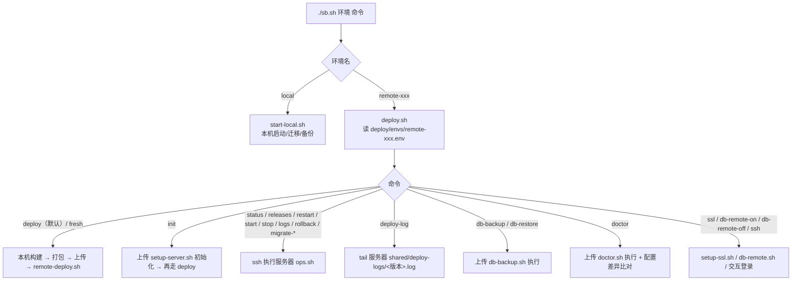
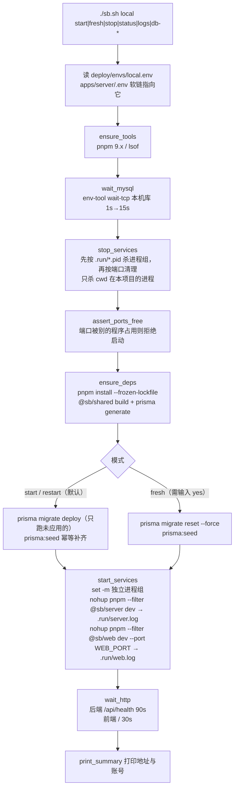
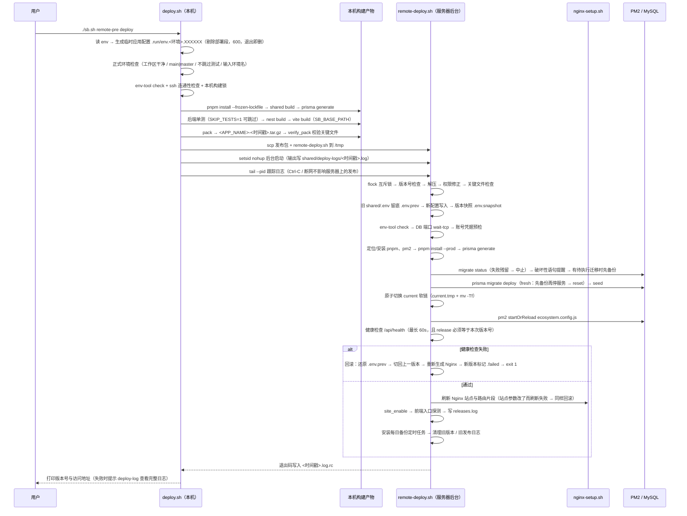
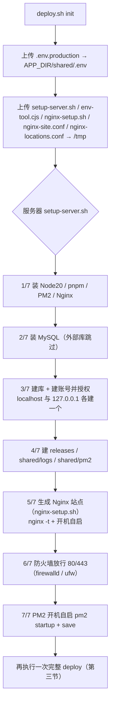
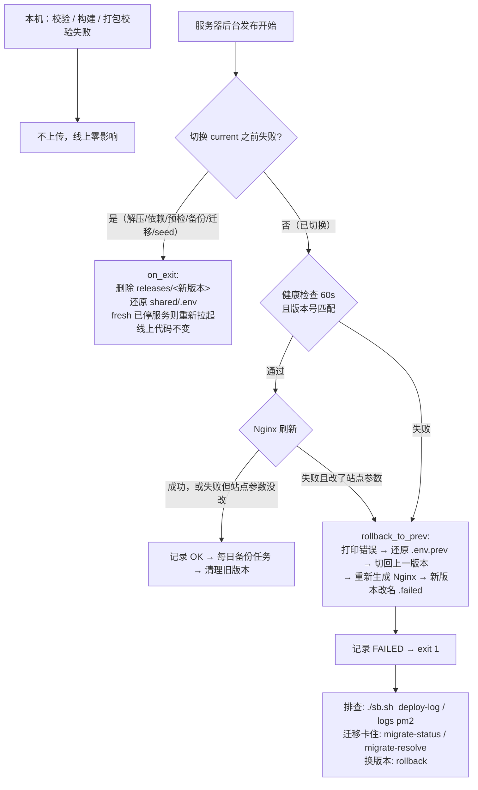

# 本地与远程发布流程（脚本调用链）

本文梳理 `./sb.sh` 两条链路的完整执行过程：**本地开发**与**远程发布**，写到「哪个脚本、调了什么、做了什么」这一层。
Windows 版（`sb.ps1` / `deploy.ps1` / `start-local.ps1`）逻辑一致，脚本名不同，本文以 Mac/Linux 版为准。

- 配置来源：`deploy/envs/<环境>.env`（一份文件同时含部署段与应用段，详见 [deploy.md](./deploy.md)）
- 配置读取统一走 `deploy/server/env-tool.cjs`（`check` / `get` / `db` / `wait-tcp`），bash 与 PowerShell 共用一个解析器

---

## 一、入口分发



**`sb.sh` 做的两件事**（`sb.sh` 末尾的 `case`）：
1. `local` → `exec bash start-local.sh <命令>`
2. `remote-*` → 检查 `deploy/envs/<环境>.env` 存在（不存在提示 `cp deploy/envs/remote.env.example`），然后 `exec bash deploy.sh <环境> <命令>`

环境名不写死：`remote-*` 通配，新增环境只需复制模板建 env 文件，无需改脚本。

---

## 二、本地流程（`./sb.sh local ...` → `start-local.sh`）



### 逐步说明（脚本 → 动作）

| 步骤 | 脚本/位置 | 实际动作 |
|---|---|---|
| 配置同步 | `start-local.sh:55-58` | `apps/server/.env` 软链到 `deploy/envs/local.env`（唯一配置源） |
| 工具检查 | `ensure_tools` | 校验 `pnpm` 为 9.x、`lsof` 存在 |
| 等数据库 | `wait_mysql` | `node env-tool.cjs wait-tcp <host> <port>`，先探 1s，不通再等 15s；仍不通提示启动 MySQL |
| 停旧进程 | `stop_services` | 先按 `.run/server.pid`、`.run/web.pid` 杀整个进程组（`kill -- -PID`），再按 `PORT`/`WEB_PORT` 兜底；**只杀 cwd 在本项目的进程**（`is_ours`），不会误杀别的项目 |
| 端口检查 | `assert_ports_free` | 端口被非本项目进程占用 → 报错退出并提示 PID 与路径，绝不杀别人的进程 |
| 依赖 | `ensure_deps` | `node_modules` 缺失或 lockfile 更新时 `pnpm install --frozen-lockfile`；构建 `@sb/shared`；`prisma generate` |
| 迁移/种子 | `db_migrate` / `db_fresh` | `prisma migrate deploy` + `pnpm --filter @sb/server prisma:seed`（ts-node 执行 `src/database/seed.ts`，幂等）；`fresh` 先 `prisma migrate reset --force` |
| 启动 | `start_services` | `set -m` 让后台进程独立成组；后端 Nest watch 模式、前端 Vite（代理到后端 PORT），输出分别写 `.run/server.log` / `.run/web.log` |
| 就绪检查 | `wait_http` | 轮询 HTTP 码，`/api/health` 等 90s、前端等 30s，超时打印日志尾部 |

### 本地其他命令

| 命令 | 执行逻辑 |
|---|---|
| `stop` | `stop_services`：杀进程组 + 按端口清理（同上） |
| `status` | 按端口查 PID（区分本项目/其他程序）+ MySQL TCP 探活 + `curl /api/health` |
| `logs` | `tail -n 30 -F .run/server.log .run/web.log` |
| `db-backup [备注]` | `mysqldump --set-gtid-purged=OFF（GTID 开启时）--no-tablespaces --single-transaction \| gzip` → `backup/local/<库>_<时间>_<备注>.sql.gz`；清理 7 天前备份 |
| `db-restore <文件>` | 输入库名确认 → 先自动备份当前库（`auto-before-restore`）→ 剔除 GTID 语句后 `mysql` 导入 |
| `db-list` | 列出 `backup/local/*.sql.gz` |

> 限制：`DATABASE_URL` 主机必须是 `localhost` / `127.0.0.1`，本地脚本拒绝操作远程库（防误清）。

---

## 三、远程日常发布（`./sb.sh remote-pre deploy`）

### 3.1 时序



### 3.2 本机阶段（`deploy.sh`）

| 步骤 | 函数/位置 | 动作 |
|---|---|---|
| 读配置 | 「一、读取环境配置」 | 读 `SSH_HOST/PORT/USER/PASSWORD`、`DEPLOY_DIR`、`APP_NAME`、`KEEP_RELEASES`、`NPM_REGISTRY`、`DB_ROOT_PASS`（环境变量优先）、`PROTECTED`；校验 `HOST` 不是占位符、`DEPLOY_DIR` 为只含安全字符的绝对路径、`APP_NAME` 符合 `^[a-z][a-z0-9-]*$`；从 `package.json` 的 `packageManager` 取 pnpm 版本 |
| 拆分配置 | 「二、应用配置文件」 | 剔除部署专用键（`DEPLOY_KEYS`，兼容 `export KEY=` 写法），写入**每次执行独立**的临时文件 `.run/env.<环境>.XXXXXX`（600）——**这是唯一会上传到服务器的应用配置**；`trap cleanup_local EXIT` 退出时删除它、发布包、暂存目录、构建锁 |
| SSH 方式 | 「三、SSH 执行」 | 有 `SSH_PASSWORD` → `sshpass -e`（密码经 `SSHPASS` 传入，不出现在进程参数）；否则免密（`BatchMode=yes`）；均自动接受新主机指纹 |
| 正式环境检查 | `guard_release` / `confirm_env` | `PROTECTED=1`（或环境名 `remote-release`）时：工作区无未提交改动、在 main/master、未设 `SKIP_TESTS=1`（`FORCE=1` 跳过），再输入环境名确认（`CONFIRM=<环境名>` 跳过） |
| 构建锁 | `acquire_local_lock` | `mkdir .run/build.lock` 原子锁：同一工作目录同时只允许一个构建（`dist` 只有一份，并发会串环境） |
| 构建 | `build()` | `pnpm install --frozen-lockfile` → `@sb/shared build` → `prisma generate` → 后端单测 → `nest build` → `SB_BASE_PATH=<SITE_PATH/> vite build` |
| 打包 | `pack()` | 暂存目录只放运行所需（见第六节）；`RELEASE` 写入版本号/环境/构建时间/commit（有未提交改动时带 `-dirty`）；**直接调用而非 `$(pack)`**，保证出错即中止 |
| 校验包 | `verify_pack()` | `tar -tzf` 检查 `main.js`、`seed.js`、`schema.prisma`、`migrations/`、`index.html`、`remote-deploy.sh`、`.env.production`、`RELEASE`，缺一个都不上传 |
| 后台执行 | `start_remote_deploy()` | `scp` 包与脚本到 `/tmp` → 远端 `setsid nohup bash remote-deploy.sh ... > shared/deploy-logs/<时间戳>.log &`，传入 `SB_PID_FILE` / `SB_RC_FILE` / `SB_CLEANUP` / `NPM_REGISTRY` / `PNPM_VERSION` / `SKIP_DB_BACKUP` / `FORCE_FRESH` |
| 跟踪结果 | `follow_remote_log()` | 等待 `.pid` 出现 → `tail -n +1 -f --pid` 跟到进程结束 → 读 `.rc` 作为退出码；255 = 连接中断（发布继续）、99 = 进程异常退出 |
| 结果提示 | `deploy()` 末尾 | 访问地址 = `CORS_ORIGINS` 第一个 + `SITE_PATH`；`fresh` 额外提示默认账号与首登改密 |

### 3.3 服务器阶段（`deploy/server/remote-deploy.sh`）

| 步骤 | 脚本章节 | 动作 |
|---|---|---|
| 互斥与版本号 | 三 | `flock -n` 独占 `.deploy.lock`（rollback / migrate-resolve 共用）；版本号等于线上版本 → 拒绝（防 `rm -rf` 删掉线上目录）；早于线上版本 → 提醒检查本机时间 |
| 解压与权限 | 四 | `tar -xzf` 到 `releases/<时间戳>`；`chown root` + `chmod go+rX`（nginx worker 可读静态资源）；脚本转 LF；**关键产物缺失立即中止** |
| 配置落位 | 五 | 旧 `shared/.env` → `.env.prev`；包内 `.env.production` 原子写入 `shared/.env`（600）；`env-tool check`；本版本快照 `.env.snapshot`（600，rollback 时恢复）；软链 `.env` / `logs` |
| 上传文件 | 六 | 所有版本目录的 `apps/server/uploads` 软链到 `shared/uploads`（兼容历史残留文件） |
| 数据库预检 | 七 | `wait-tcp` 等 30s，本机 MySQL 未监听自动 `systemctl start`；账号实际登录一次（防 P1000） |
| 依赖 | 八 | 定位/安装 `pnpm`、`pm2`；`pnpm install --prod --frozen-lockfile`（失败提示换 `NPM_REGISTRY`）；`prisma generate` |
| 迁移 | 九 | `migrate status`：有失败残留（P3009）→ 中止并给出 `migrate-status` / `migrate-resolve` 指引；列出待执行迁移并扫描 `DROP TABLE/COLUMN`、`RENAME`、`MODIFY` 等破坏性语句；**有待执行迁移时先备份（`auto-before-migrate`），备份失败中止**；`migrate deploy` 失败给出恢复指引 |
| fresh | 九（F） | **先备份**（失败中止，`FORCE_FRESH=1` 跳过）→ 再停 PM2 → `migrate reset`；停服务之后任何一步失败都会重新拉起服务 |
| 种子 | 九 | `node dist/database/seed.js` 幂等补齐（生产环境新建的超管首次登录必须改密） |
| 版本切换 | 十 | `current.tmp` + `mv -Tf` 原子切换 → `pm2 startOrReload --update-env` + `pm2 save` |
| 健康检查 | 十 | 轮询 `/api/health` 最长 60s，**返回体中 `release` 必须等于本次版本号**（防止旧进程没被替换却误判成功）；失败 → 打印错误 → `rollback_to_prev` |
| 自动回滚 | `rollback_to_prev` | 还原 `.env.prev` → 切回上一版本 → reload → 宽松健康检查 → 用上一版本的 `nginx-setup.sh` 重新生成路由 → 新版本改名 `.failed` → 记录 FAILED → `exit 1`（**数据库迁移不回退**） |
| Nginx | 十一 | `nginx-setup.sh` 刷新；失败且本次改了 `SITE_PORT/SITE_DOMAIN/SITE_PATH` → 回滚；`site_enable` 恢复曾被 stop 的站点；`probe_frontend` 经 Nginx 请求首页（失败只警告） |
| 收尾 | 十二 | 写 `releases.log`；安装 `/etc/cron.d/<APP>-db-backup` 每日备份（`DB_BACKUP_CRON` 可改时间或 `off`）；保留最近 `KEEP_RELEASES` 个版本、1 个 `.failed`、20 份发布日志 |
| 退出 | `on_exit` | 切换前失败：删半成品、还原配置、fresh 拉起服务、记录 FAILED；无论成败：删除 `/tmp` 发布包与脚本，写 `.rc` 退出码 |

---

## 四、首次初始化（`./sb.sh remote-pre init`）



要点：
- **幂等**，可重复执行（已存在的不覆盖，`ALTER USER` 会把账号密码同步为当前 env 里的值 —— 改了 `DATABASE_URL` 密码后重跑 `init` 即可修复 P1000）
- MySQL 8 默认密码策略会拒绝弱密码：建账号期间临时放宽为 `LOW`，完成后恢复
- 使用云数据库（`DATABASE_URL` 主机非本机）时跳过 2/7、3/7，需在云控制台自建库与账号
- MySQL root 密码（`DB_ROOT_PASS`）以文件上传到权限 700 的临时目录、读后即删，含密码的 SQL 经 stdin / `MYSQL_PWD` 传给 mysql，不出现在任何进程参数里；用初始临时密码自动重置的 root 密码保存在服务器 `/root/.mysql-root-pass`（600）
- 正式环境的 `init` 同样要求工作区干净、main/master 分支并输入环境名确认

---

## 五、远程运维命令调用链

| 命令 | 本机脚本 | 服务器脚本 | 服务器实际动作 |
|---|---|---|---|
| `deploy-log [版本号]` | `deploy.sh` → `follow_remote_log` | — | 读 `shared/deploy-logs/<版本号>.log`（默认最近一次）；发布仍在进行则持续跟踪，结束后按 `.rc` 报告成功/失败 |
| `status` | `deploy.sh` → `ssh` | `ops.sh APP_DIR APP_NAME status` | 当前版本、`pm2 describe`、nginx/mysql 服务状态、是否处于维护页、`curl /api/health`、今日 ERROR/WARN 计数、磁盘 |
| `logs [级别\|pm2\|follow] [日期]` | `deploy.sh`（参数白名单校验：级别仅字母、日期 `YYYY-MM-DD`） | `ops.sh logs` | 默认 `shared/logs/app.今天.log` 最近 100 行；`pm2` 看进程输出；`follow` 持续跟踪 |
| `releases` | `deploy.sh` | `ops.sh releases` | 列出 `releases/` 并标出当前版本 + `releases.log` 最近 5 条 |
| `rollback [版本号]` | 校验 14 位时间戳；正式环境输入环境名确认 | `ops.sh rollback` | 获取发布锁 → 恢复目标版本的 `.env.snapshot`（原配置留底 `.env.prev`）→ 切换 `current` → `pm2 startOrReload` → 按目标版本重新生成 Nginx 路由 → 健康检查 60s；**数据库不回退** |
| `restart` | `deploy.sh` | `ops.sh restart` | 只重载 PM2 |
| `start` / `stop` | `deploy.sh`（stop 正式环境需确认） | `ops.sh` | **站点级**启停，同机其他环境不受影响。`stop`：路由片段换成「503 维护中」（子路径共享域名模式也能真正下线）+ 摘本应用站点 + 停 PM2；`start`：先起 PM2 等健康检查，再恢复路由与站点 |
| `migrate-status` | `deploy.sh` | `ops.sh migrate-status` | `prisma migrate status`（待执行 / 执行失败的迁移） |
| `migrate-resolve <applied\|rolled-back> <迁移名>` | 参数校验；正式环境需确认 | `ops.sh migrate-resolve` | 获取发布锁 → `prisma migrate resolve`（人工补齐/撤销失败迁移后解除 P3009 阻塞） |
| `ssl 域名` | 校验域名格式 | `setup-ssl.sh` | 子路径部署直接拒绝；否则 certbot 申请证书 + HTTP 301 跳转 + 自动续期（已配 HTTPS 的站点不会被发布覆盖） |
| `db-remote-on/off [IP]` | `deploy.sh`（交互 tty） | `db-remote.sh` | 临时建/删远程账号 + 监听地址切换 + 重启 MySQL（用完务必关闭） |
| `db-backup [备注]` | 上传 `db-backup.sh` → 执行 → 按最后一行 `BACKUP_FILE=` 取路径 → `scp` 拉回 `backup/<环境>/` | `db-backup.sh backup` | `mysqldump`（`--set-gtid-purged=OFF`、`--no-tablespaces`）→ `shared/backup/`（保留 7 天） |
| `db-restore <文件>` | 输入库名确认 → 上传备份与脚本 | `db-backup.sh restore` | 先备份当前库 → 停应用 → 清空库内全部表 → 导入 → `migrate deploy` 对齐到当前代码 → 启动应用（失败也会重新启动） |
| `doctor` | 上传本地应用配置作为「期望值」 | `doctor.sh APP_DIR APP_NAME <期望env>` | 版本/配置快照/PM2/Nginx/MySQL/健康检查/磁盘/今日错误/最近一次发布/备份与每日任务 + **逐键比对本地 env 与服务器 `shared/.env`** |
| `ssh` | `deploy.sh` | — | 交互式登录（有密码走 `sshpass -t`） |

除 `deploy-log` 外，运维命令都先 `need_release`（检查 `APP_DIR/current` 软链存在），否则提示先 `init`。

---

## 六、发布包内容与服务器目录

**发布包（`pack()` 打进 tar 的内容，`verify_pack()` 校验）**

```
package.json  pnpm-workspace.yaml  pnpm-lock.yaml
packages/shared/{package.json, dist/}
apps/server/{package.json, dist/, prisma/}       # prisma 含迁移 SQL，服务器上 migrate deploy 用
apps/web/{package.json, dist/}                   # 前端构建产物（已按 SITE_PATH 注入 base）
deploy/server/                                   # 所有服务器脚本随版本走
.env.production                                  # 应用配置（不含 SSH/部署段）
RELEASE                                          # 版本号（健康检查校验用）、环境、构建时间、构建人、commit（-dirty）
```

`node_modules` 不打包：服务器按同一份 lockfile `pnpm install --prod` 安装。

**服务器目录**

```
APP_DIR/
├── current -> releases/20261011145911          # Nginx 与 PM2 都指向这里，回滚 = 改软链
├── releases/<时间戳>/                          # 每次发布一个目录，保留最近 KEEP_RELEASES 个
│   ├── .env.snapshot                           # 该版本发布时的配置（600），rollback 时恢复
│   └── <时间戳>.failed                         # 健康检查失败的版本，保留最近 1 个现场
├── shared/                                     # 跨版本共享
│   ├── .env / .env.prev  （600：当前配置 / 上次发布或回滚前的配置）
│   ├── logs/         （应用日志 app.YYYY-MM-DD.log）
│   ├── pm2/          （PM2 输出与错误日志）
│   ├── uploads/      （上传文件，各版本软链到这里）
│   ├── backup/       （数据库备份，保留 7 天；cron.log 为每日备份输出）
│   └── deploy-logs/  （每次发布的完整输出 <时间戳>.log / .rc / .pid，保留 20 次）
├── releases.log                                # 发布/回滚记录
└── .deploy.lock                                # 发布 / 回滚 / 标记迁移的互斥锁
/etc/cron.d/<APP_NAME>-db-backup                # 每日数据库备份（发布时安装/刷新）
/etc/nginx/snippets/<APP_NAME>-locations.conf   # 路由片段（stop 时换成维护页，真实路由备份为 .disabled）
```

---

## 七、失败与回滚路径



关键设计：
- **断网不中断**：服务器端在后台运行，本机只是「看日志」；`deploy-log` 随时可重新查看
- **切换前失败**：新版本目录删除、配置还原，线上零影响
- **切换后失败**：代码、配置、Nginx 一起回到上一版本；**数据库迁移不会回退**，所以迁移要向下兼容（有破坏性语句时发布日志会提醒）
- **迁移前自动备份**：有待执行迁移时先备份，备份失败直接中止；另有每日定时备份（与数据库同机，重要数据请另行异地存储）
- **人为回滚**：`rollback` 恢复代码 + 该版本配置快照 + Nginx 路由，同样不回退数据库
- **Nginx 改动**：`nginx-setup.sh` 改配置前先备份，`nginx -t` 失败自动还原全部文件；注入共享域名前会清掉本应用旧的注入

---

## 八、脚本职责速查

| 脚本 | 运行位置 | 职责 |
|---|---|---|
| `sb.sh` / `sb.ps1` | 本机 | 统一入口，按环境名分发（新增环境无需改它） |
| `start-local.sh` / `.ps1` | 本机 | 本地启停、迁移、种子、本地库备份恢复 |
| `deploy.sh` / `deploy.ps1` | 本机 | 读 env、拆分配置、正式环境检查、构建、打包校验、上传、后台启动并跟踪服务器发布、运维命令转发 |
| `deploy/server/env-tool.cjs` | 本机 + 服务器 | 解析 `.env` 与 `DATABASE_URL`：`check`（生产配置校验）/ `get` / `db`（拆 5 行）/ `wait-tcp` |
| `deploy/server/env-diff.cjs` | 服务器（doctor） | 比对两份 `.env` 的键（不打印值） |
| `deploy/server/setup-server.sh` | 服务器（init） | 装运行环境、建库建账号（密码经 stdin / MYSQL_PWD）、生成站点、放行防火墙、PM2 自启 |
| `deploy/server/remote-deploy.sh` | 服务器（每次发布，后台） | 解压 → 配置落位与快照 → 预检 → 装依赖 → 迁移检查/备份/迁移/种子 → 原子切换 → 版本化健康检查 → 失败回滚 → Nginx → 每日备份任务 |
| `deploy/server/nginx-setup.sh` | 服务器（init / 发布 / 回滚） | 生成路由片段与站点 server 块；子路径部署时清理旧注入后注入共享域名 server 块；`nginx -t` 失败自动还原 |
| `deploy/server/ops.sh` | 服务器 | `status` / `logs` / `releases` / `rollback` / `restart` / `start` / `stop` / `migrate-status` / `migrate-resolve` |
| `deploy/server/db-backup.sh` | 服务器（命令 / 发布 / 每日定时） | 备份（最后一行输出 `BACKUP_FILE=`）与恢复（备份当前库 → 停应用 → 清表 → 导入 → 迁移 → 启动） |
| `deploy/server/db-remote.sh` | 服务器 | 临时开放/关闭数据库远程访问 |
| `deploy/server/doctor.sh` | 服务器 | 环境体检 + 本地/服务器配置差异比对 |
| `deploy/server/setup-ssl.sh` | 服务器 | Let's Encrypt 证书 + 301 跳转 + 自动续期（子路径部署拒绝执行） |
| `deploy/server/ecosystem.config.js` | 服务器 | PM2 应用定义（`startOrReload` 用它保持进程配置同步） |
