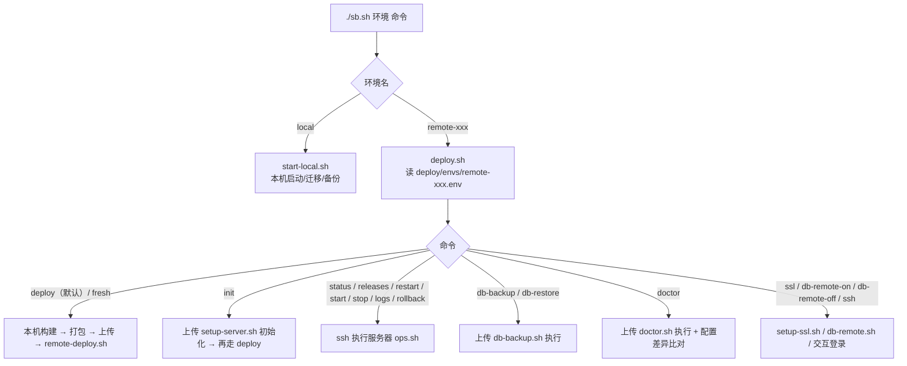
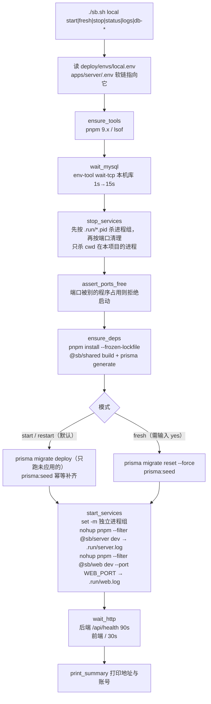
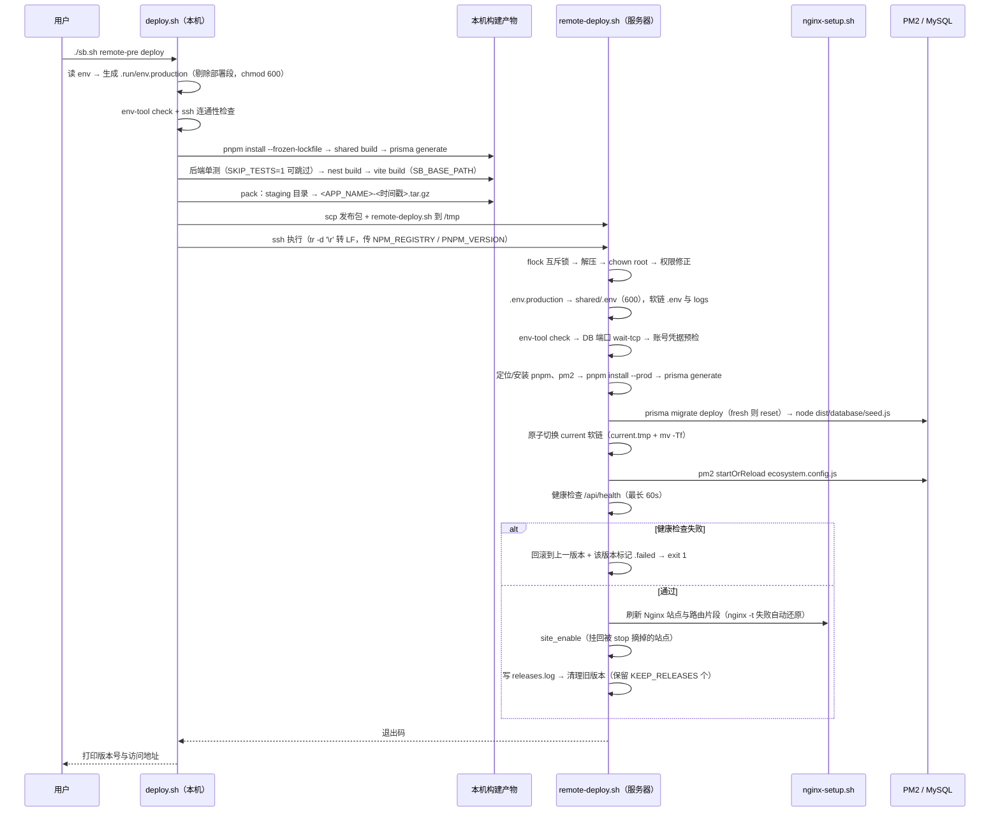
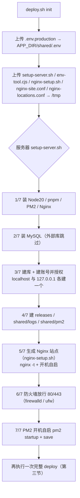
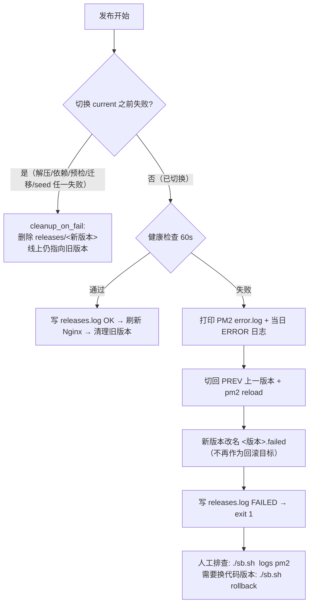

# 本地与远程发布流程（脚本调用链）

本文梳理 `./sb.sh` 两条链路的完整执行过程：**本地开发**与**远程发布**，写到「哪个脚本、调了什么、做了什么」这一层。
Windows 版（`sb.ps1` / `deploy.ps1` / `start-local.ps1`）逻辑一致，脚本名不同，本文以 Mac/Linux 版为准。

- 配置来源：`deploy/envs/<环境>.env`（一份文件同时含部署段与应用段，详见 [deploy.md](./deploy.md)）
- 配置读取统一走 `deploy/server/env-tool.cjs`（`check` / `get` / `db` / `wait-tcp`），bash 与 PowerShell 共用一个解析器

---

## 一、入口分发



**`sb.sh` 做的两件事**（`sb.sh:129-137`）：
1. `local` → `exec bash start-local.sh <命令>`
2. `remote-*` → 检查 `deploy/envs/<环境>.env` 存在（不存在提示 `cp deploy/envs/remote.env.example`），然后 `exec bash deploy.sh <环境> <命令>`

环境名不写死：`remote-*` 通配，新增环境只需复制模板建 env 文件，无需改脚本。

---

## 二、本地流程（`./sb.sh local ...` → `start-local.sh`）



### 逐步说明（脚本 → 动作）

| 步骤 | 脚本/位置 | 实际动作 |
|---|---|---|
| 配置同步 | `start-local.sh:55-58` | `apps/server/.env` 软链到 `deploy/envs/local.env`（唯一配置源） |
| 工具检查 | `ensure_tools` | 校验 `pnpm` 为 9.x、`lsof` 存在 |
| 等数据库 | `wait_mysql` | `node env-tool.cjs wait-tcp <host> <port>`，先探 1s，不通再等 15s；仍不通提示启动 MySQL |
| 停旧进程 | `stop_services` | 先按 `.run/server.pid`、`.run/web.pid` 杀整个进程组（`kill -- -PID`），再按 `PORT`/`WEB_PORT` 兜底；**只杀 cwd 在本项目的进程**（`is_ours`），不会误杀别的项目 |
| 端口检查 | `assert_ports_free` | 端口被非本项目进程占用 → 报错退出并提示 PID 与路径，绝不杀别人的进程 |
| 依赖 | `ensure_deps` | `node_modules` 缺失或 lockfile 更新时 `pnpm install --frozen-lockfile`；构建 `@sb/shared`；`prisma generate` |
| 迁移/种子 | `db_migrate` / `db_fresh` | `prisma migrate deploy` + `pnpm --filter @sb/server prisma:seed`（ts-node 执行 `src/database/seed.ts`，幂等）；`fresh` 先 `prisma migrate reset --force` |
| 启动 | `start_services` | `set -m` 让后台进程独立成组；后端 Nest watch 模式、前端 Vite（代理到后端 PORT），输出分别写 `.run/server.log` / `.run/web.log` |
| 就绪检查 | `wait_http` | 轮询 HTTP 码，`/api/health` 等 90s、前端等 30s，超时打印日志尾部 |

### 本地其他命令

| 命令 | 执行逻辑 |
|---|---|
| `stop` | `stop_services`：杀进程组 + 按端口清理（同上） |
| `status` | 按端口查 PID（区分本项目/其他程序）+ MySQL TCP 探活 + `curl /api/health` |
| `logs` | `tail -n 30 -F .run/server.log .run/web.log` |
| `db-backup [备注]` | `mysqldump --set-gtid-purged=OFF（GTID 开启时）--no-tablespaces --single-transaction \| gzip` → `backup/local/<库>_<时间>_<备注>.sql.gz`；清理 7 天前备份 |
| `db-restore <文件>` | 输入库名确认 → 先自动备份当前库（`auto-before-restore`）→ 剔除 GTID 语句后 `mysql` 导入 |
| `db-list` | 列出 `backup/local/*.sql.gz` |

> 限制：`DATABASE_URL` 主机必须是 `localhost` / `127.0.0.1`，本地脚本拒绝操作远程库（防误清）。

---

## 三、远程日常发布（`./sb.sh remote-pre deploy`）

### 3.1 时序



### 3.2 本机阶段（`deploy.sh`）

| 步骤 | 位置 | 动作 |
|---|---|---|
| 读配置 | `deploy.sh:55-74` | 读 `SSH_HOST/PORT/USER/PASSWORD`、`DEPLOY_DIR`、`APP_NAME`、`KEEP_RELEASES`、`NPM_REGISTRY`、`DB_ROOT_PASS`（环境变量优先）；校验 `HOST` 不是占位符、`DEPLOY_DIR` 为绝对路径、`APP_NAME` 符合 `^[a-z][a-z0-9-]*$`；从 `package.json` 的 `packageManager` 取 pnpm 版本 |
| 拆分配置 | `deploy.sh:77-79` | 剔除部署专用键（SSH_*/DEPLOY_DIR/APP_NAME/KEEP_RELEASES/NPM_REGISTRY/DB_ROOT_PASS），生成 `.run/env.production` 并 `chmod 600`——**这是唯一会上传到服务器的应用配置** |
| SSH 方式 | `deploy.sh:82-95` | 有 `SSH_PASSWORD` → `sshpass -e`（密码经 `SSHPASS` 传入，不出现在进程参数）；否则免密（`BatchMode=yes`）；均自动接受新主机指纹 |
| 构建 | `build()` | `pnpm install --frozen-lockfile` → `pnpm --filter @sb/shared build` → `prisma generate` → 后端单测（`SKIP_TESTS=1` 跳过）→ `nest build` → 前端 `SB_BASE_PATH=<SITE_PATH 带尾斜杠> vite build`（子路径部署在这里生效） |
| 打包 | `pack()` | 暂存目录只放运行所需：`package.json`、`pnpm-workspace.yaml`、`pnpm-lock.yaml`、`packages/shared/{package.json,dist}`、`apps/server/{package.json,dist,prisma}`、`apps/web/{package.json,dist}`、`deploy/server/`、`.env.production`、`RELEASE`（版本/环境/构建时间/commit）；`COPYFILE_DISABLE=1 tar czf`（macOS 不打扩展属性） |
| 上传执行 | `deploy.sh:181-189` | `scp` 发布包与 `remote-deploy.sh` 到 `/tmp`；远端 `tr -d '\r'` 转 LF 后执行，参数：`APP_DIR /tmp/<包> MODE APP_NAME KEEP`，环境变量 `NPM_REGISTRY`、`PNPM_VERSION`；执行完删除 `/tmp` 临时文件；本机 `trap` 保证删除发布包 |
| 结果提示 | `deploy.sh:192-197` | 访问地址 = `CORS_ORIGINS` 第一个 + `SITE_PATH`；`fresh` 额外提示默认账号 |

### 3.3 服务器阶段（`deploy/server/remote-deploy.sh`）

| 步骤 | 位置 | 动作 |
|---|---|---|
| 互斥锁 | `:47-49` | `flock -n` 独占 `.deploy.lock`，并发发布会直接提示退出 |
| 解压与权限 | `:63-71` | `tar -xzf` 到 `releases/<时间戳>`；`chown -R root:root` + `chmod u+rwX,go+rX`（解决 nginx worker 读不到静态资源 → 500）；`deploy/*.sh` 转 LF |
| 配置落位 | `:74-83` | 包内 `.env.production` → `shared/.env`（`chmod 600`，版本目录内不保留密钥）；`env-tool check` 校验；软链 `apps/server/.env → shared/.env`、`apps/server/logs → shared/logs`；读取 `PORT` |
| 数据库预检 | `:85-109` | `env-tool wait-tcp` 等 30s；本机 MySQL 未监听则 `systemctl start mysqld/mysql` 再等 60s；外部库不可达直接退出并提示 |
| 凭据预检 | `:111-128` | 用 `DATABASE_URL` 的账号实际登录一次（`mysql -e "USE 库; SELECT 1"`），避免装完依赖才在 `migrate` 处报 P1000；失败给出「重跑 init / 核对密码」指引 |
| 依赖 | `:130-155` | `ensure_global_bin` 定位/安装 `pnpm`（按 `PNPM_VERSION`）与 `pm2` 并把 npm 全局 bin 加入 PATH；`pnpm install --prod --frozen-lockfile --filter "@sb/server..."`；`prisma generate` |
| 迁移与种子 | `:157-177` | 常规：`prisma migrate deploy`（只跑未应用的，不删数据）；`fresh`：先停 PM2 → 自动备份（`auto-before-fresh`）→ `prisma migrate reset --force`；随后 `node dist/database/seed.js` 幂等补齐种子 |
| SELinux | `:179-182` | `getenforce=Enforcing` 时给前端 `dist` 打 `httpd_sys_content_t` |
| 版本切换 | `:185-206` | `ln -sfn` 到 `current.tmp` 再 `mv -Tf` 覆盖 `current`（原子切换，任何时刻 `current` 都指向完整版本）；`pm2 startOrReload deploy/server/ecosystem.config.js --update-env` + `pm2 save` |
| 健康检查 | `:194-223` | 轮询 `http://127.0.0.1:PORT/api/health` 最长 60s；失败 → 打印 PM2 error 日志与当日 ERROR 日志 → 切回上一版本并重启 → 新版本改名 `*.failed` → `exit 1`（**已执行的迁移不回退**） |
| 刷新站点 | `:226-232` | 调用 `nginx-setup.sh` 重新生成站点与路由片段（`SITE_PORT`/`SITE_DOMAIN`/`SITE_PATH` 改动无需重新 init） |
| 站点挂载 | `:236-245` | `site_enable`：把之前 `stop` 摘掉的站点配置挂回（`.disabled` 改名 / 重建 `sites-enabled` 软链），`systemctl reload nginx` |
| 记录与清理 | `:247-256` | 写 `releases.log`；保留最近 `KEEP_RELEASES` 个版本（当前版本不删），`.failed` 只保留最近 1 个 |

---

## 四、首次初始化（`./sb.sh remote-pre init`）



要点：
- **幂等**，可重复执行（已存在的不覆盖，`ALTER USER` 会把账号密码同步为当前 env 里的值 —— 改了 `DATABASE_URL` 密码后重跑 `init` 即可修复 P1000）
- MySQL 8 默认密码策略会拒绝弱密码：建账号期间临时放宽为 `LOW`，完成后恢复
- 使用云数据库（`DATABASE_URL` 主机非本机）时跳过 2/7、3/7，需在云控制台自建库与账号

---

## 五、远程运维命令调用链

| 命令 | 本机脚本 | 服务器脚本 | 服务器实际动作 |
|---|---|---|---|
| `status` | `deploy.sh` → `ssh` | `ops.sh APP_DIR APP_NAME status` | 当前版本、`pm2 describe`、nginx/mysql 服务状态、`curl /api/health`、今日 ERROR/WARN 计数、磁盘 |
| `logs [级别\|pm2\|follow] [日期]` | `deploy.sh`（参数白名单校验：级别仅字母、日期 `YYYY-MM-DD`） | `ops.sh logs` | 默认 `shared/logs/app.今天.log` 最近 100 行；`pm2` 看进程输出；`follow` 持续跟踪 |
| `releases` | `deploy.sh` | `ops.sh releases` | 列出 `releases/` 并标出当前版本 + `releases.log` 最近 5 条 |
| `rollback [版本号]` | 校验 14 位时间戳 | `ops.sh rollback` | 把 `current` 软链切回上一/指定版本 → `pm2 startOrReload` → 健康检查 60s；**数据库不回退** |
| `restart` / `start` / `stop` | `deploy.sh` | `ops.sh` | `restart` 只重载 PM2；`start`/`stop` 是**站点级**启停（挂回/摘掉本环境 Nginx 配置 + PM2），同机其他环境不受影响 |
| `ssl 域名` | 校验域名格式 | `setup-ssl.sh` | certbot 申请证书 + HTTP 301 跳转 + 自动续期（已配 HTTPS 的站点不会被覆盖） |
| `db-remote-on/off [IP]` | `deploy.sh`（交互 tty） | `db-remote.sh` | 临时建/删远程账号 + 监听地址切换 + 重启 MySQL（用完务必关闭） |
| `db-backup [备注]` | `deploy.sh`：上传 `db-backup.sh` → 执行 → `scp` 拉回 `backup/<环境>/` | `db-backup.sh backup` | 服务器 `mysqldump`（`--set-gtid-purged=OFF`、`--no-tablespaces`）→ `shared/backup/`（保留 7 天），再拉回本地一份 |
| `db-restore <文件>` | 输入库名确认 → 上传备份与脚本 | `db-backup.sh restore` | 恢复前自动备份当前库 → 剔除 GTID 语句 → `mysql` 导入 |
| `doctor` | 上传本地应用配置作为「期望值」 | `doctor.sh APP_DIR APP_NAME <期望env>` | 版本/PM2/Nginx/MySQL/健康检查/磁盘/今日错误/备份 + **逐键比对本地 env 与服务器 `shared/.env`**（防改了配置忘记发布） |
| `ssh` | `deploy.sh` | — | 交互式登录（有密码走 `sshpass -t`） |

所有运维命令都先 `need_release`（检查 `APP_DIR/current` 软链存在），否则提示先 `init`。

---

## 六、发布包内容与服务器目录

**发布包（`pack()` 打进 tar 的内容）**

```
package.json  pnpm-workspace.yaml  pnpm-lock.yaml
packages/shared/{package.json, dist/}
apps/server/{package.json, dist/, prisma/}       # prisma 含迁移 SQL，服务器上 migrate deploy 用
apps/web/{package.json, dist/}                   # 前端构建产物（已按 SITE_PATH 注入 base）
deploy/server/                                   # 所有服务器脚本随版本走
.env.production                                  # 应用配置（不含 SSH/部署段）
RELEASE                                          # 版本、环境、构建时间、构建人、commit
```

`node_modules` 不打包：服务器按同一份 lockfile `pnpm install --prod` 安装。

**服务器目录**

```
APP_DIR/
├── current -> releases/20261011145911          # Nginx 与 PM2 都指向这里，回滚 = 改软链
├── releases/<时间戳>/                          # 每次发布一个目录，保留最近 KEEP_RELEASES 个
│   └── <时间戳>.failed                         # 健康检查失败的版本，保留最近 1 个现场
├── shared/                                     # 跨版本共享
│   ├── .env          （600，唯一配置源）
│   ├── logs/         （应用日志 app.YYYY-MM-DD.log）
│   ├── pm2/          （PM2 输出与错误日志）
│   └── backup/       （数据库备份，滚动清理）
├── releases.log                                # 发布/回滚记录
└── .deploy.lock                                # 发布互斥锁
```

---

## 七、失败与回滚路径



关键设计：
- **切换前失败**：新版本目录直接删除，线上零影响（`SWITCHED` 标记）
- **切换后失败**：自动回到上一版本；**数据库迁移不会回退**，所以迁移要向下兼容
- **人为回滚**：`rollback` 只换代码软链，同样不回退数据库
- **Nginx 改动**：`nginx-setup.sh` 改配置前先备份，`nginx -t` 失败自动还原全部文件

---

## 八、脚本职责速查

| 脚本 | 运行位置 | 职责 |
|---|---|---|
| `sb.sh` / `sb.ps1` | 本机 | 统一入口，按环境名分发（新增环境无需改它） |
| `start-local.sh` / `.ps1` | 本机 | 本地启停、迁移、种子、本地库备份恢复 |
| `deploy.sh` / `deploy.ps1` | 本机 | 读 env、拆分配置、构建、打包、上传、编排服务器脚本、运维命令转发 |
| `deploy/server/env-tool.cjs` | 本机 + 服务器 | 解析 `.env` 与 `DATABASE_URL`：`check`（生产配置校验）/ `get` / `db`（拆 5 行）/ `wait-tcp` |
| `deploy/server/setup-server.sh` | 服务器（init） | 装运行环境、建库建账号、生成站点、放行防火墙、PM2 自启 |
| `deploy/server/remote-deploy.sh` | 服务器（每次发布） | 解压 → 配置落位 → 预检 → 装依赖 → 迁移/种子 → 原子切换 → 健康检查 → 失败回滚 |
| `deploy/server/nginx-setup.sh` | 服务器（init + 每次发布） | 生成路由片段、本应用站点 server 块；子路径部署时把片段注入共享域名的 server 块；`nginx -t` 失败自动还原 |
| `deploy/server/ops.sh` | 服务器 | `status` / `logs` / `releases` / `rollback` / `restart` / `start` / `stop` |
| `deploy/server/db-backup.sh` | 服务器 | 备份（`mysqldump`，GTID/PROCESS 兼容）与恢复（恢复前自动备份当前库） |
| `deploy/server/db-remote.sh` | 服务器 | 临时开放/关闭数据库远程访问 |
| `deploy/server/doctor.sh` | 服务器 | 环境体检 + 本地/服务器配置差异比对 |
| `deploy/server/setup-ssl.sh` | 服务器 | Let's Encrypt 证书 + 301 跳转 + 自动续期 |
| `deploy/server/ecosystem.config.js` | 服务器 | PM2 应用定义（`startOrReload` 用它保持进程配置同步） |
